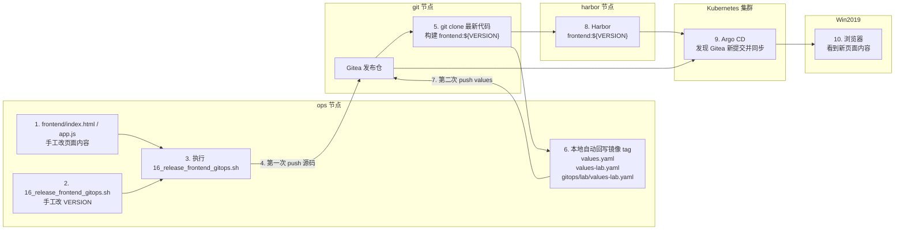
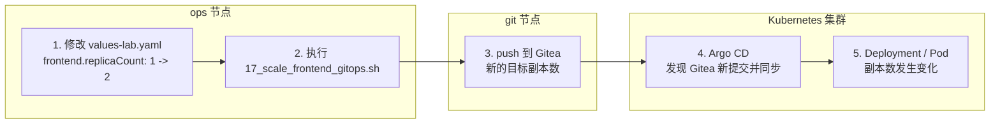

# GitOps 课堂测试与演示

## 本节目标

这一节只做两组课堂测试：

1. 改代码，发布新版本
2. 改 `values`，做声明式扩缩容

## 执行标记

- **执行标记：建议执行**

## 先看总链路

这一节不再讲新的基础设施，只看这条已经打通的 GitOps 主线：



按编号看这张图即可：

1. 先改前端页面代码
2. 再改 `VERSION`
3. 执行脚本
4. 第一次 push，把源码送到 `Gitea`
5. `git` 节点从 `Gitea` 拉最新代码并构建镜像
6. 脚本在本地自动回写镜像 tag
7. 第二次 push，把回写后的 `values` 再送到 `Gitea`
8. 新镜像进入 `Harbor`
9. `Argo CD` 发现 `Gitea` 新提交并同步
10. 浏览器看到新页面

## 测试 1：改代码发布新版本

<div style="padding: 12px 14px; border: 1px solid #666; border-left: 6px solid #8ab4f8; border-radius: 6px; background: rgba(138,180,248,0.08); margin: 10px 0;">
<strong>测试边界</strong><br/>
这一组测试只验证一件事：手工改前端代码后，执行一条脚本，页面能否通过 GitOps 自动发布出新版本。
</div>

### 第 1 步：改代码

推荐修改位置：

- `apps/qytang-netdevops/frontend/index.html`
- `apps/qytang-netdevops/frontend/app.js`

然后再改这一个变量：

- `k8s/06-gitops-and-automation/scripts/16_release_frontend_gitops.sh`

```bash
VERSION="${VERSION:-v0.1.3}"
```

这里要分清两件事：

- 页面内容改动
  - 来自你手工改 `index.html / app.js`
- `VERSION` 改动
  - 决定这次发布生成的镜像 tag

不要手工去改下面 3 个文件：

- `deploy/helm/qytang-netdevops/values.yaml`
- `deploy/helm/qytang-netdevops/values-lab.yaml`
- `deploy/gitops/lab/values-lab.yaml`

因为：

- `16_release_frontend_gitops.sh` 会自动回写这 3 处前端镜像 tag

### 第 2 步：执行脚本

<div style="padding: 12px 14px; border: 1px solid #666; border-left: 6px solid #ea4335; border-radius: 6px; background: rgba(234,67,53,0.10); margin: 8px 0;">
<strong>❗ 本条命令必须粘贴执行</strong><br/>
这一条脚本会串起“push 源码、构建镜像、回写 values、再次 push、等待 Argo CD 同步”整条发布链。
</div>

```bash
bash /docker_k8s_2026/k8s/06-gitops-and-automation/scripts/16_release_frontend_gitops.sh
```

### 第 3 步：看效果

主要看两个地方：

- `https://argocd.qytk8s.com`
- `https://netdevops.qytk8s.com`

重点看：

- `Argo CD`
  - `Sync Status=Synced`
  - `Health Status=Healthy`
  - `Revision` 已变化
- 业务页面
  - 页面内容已经变成你刚改的新版本

<div style="padding: 10px 14px; border: 1px solid #666; border-left: 4px solid #8ab4f8; border-radius: 6px; background: rgba(138,180,248,0.08); margin: 8px 0;">
<strong>ℹ️ 可选执行</strong><br/>
下面两条命令只是辅助观察，不是测试主线必跑命令。
</div>

```bash
kubectl -n argocd get application qytang-netdevops -o wide
kubectl -n qytang-netdevops get deploy frontend -o jsonpath='{.spec.template.spec.containers[0].image}{"\n"}'
```

## 测试 2：改 values 做声明式扩缩容

<div style="padding: 12px 14px; border: 1px solid #666; border-left: 6px solid #8ab4f8; border-radius: 6px; background: rgba(138,180,248,0.08); margin: 10px 0;">
<strong>测试边界</strong><br/>
这一组测试只验证一件事：不改代码、不重建镜像，只改 Git 里的目标副本数，集群也会自动收敛。
</div>

### 第 1 步：改 values

这条链路和测试 1 不一样，可以直接看下面这张图：



按编号看这张图即可：

1. 先手工修改 `values-lab.yaml` 里的目标副本数
2. 执行 `17_scale_frontend_gitops.sh`
3. 脚本把新的目标副本数同步到 `Gitea`
4. `Argo CD` 发现 `Gitea` 新提交并开始同步
5. `Deployment / Pod` 的副本数最终发生变化

<div style="padding: 12px 14px; border: 1px solid #666; border-left: 6px solid #fbbc04; border-radius: 6px; background: rgba(251,188,4,0.10); margin: 10px 0;">
<strong>YAML 卡片</strong><br/>
YAML 文件：<code>apps/qytang-netdevops/deploy/helm/qytang-netdevops/values-lab.yaml</code><br/>
对象：<code>Helm values</code><br/>
作用：课堂上手工调整 <code>replicaCount</code> 的主入口；改完以后，<code>Argo CD</code> 会把目标副本数同步到集群。
</div>

```yaml
frontend:
  replicaCount: 1
  image:
    repository: harbor.qytk8s.com/qytang-netdevops/frontend
    tag: v0.2.3

deviceService:
  replicaCount: 1

resourceService:
  replicaCount: 1

auditService:
  replicaCount: 1
```

课堂上最推荐先把：

- `frontend.replicaCount: 1`

改成：

- `frontend.replicaCount: 2`

这一段只需要抓 3 个点：

- `frontend.replicaCount`
  - 最推荐先改这里
- `deviceService / resourceService / auditService`
  - 这些也是无状态服务，也可以改副本数
- `postgres`
  - 当前不要拿来做横向扩容演示

### 第 2 步：执行脚本

在执行脚本前，建议先看一眼当前副本数基线：

```bash
kubectl -n qytang-netdevops get deploy frontend device-service resource-service audit-service
kubectl -n qytang-netdevops get pods -o wide
```

如果当前还是默认状态，你通常会看到：

- `frontend` 还是 `1/1`
- `frontend` 相关 Pod 也只有 `1` 个

<div style="padding: 12px 14px; border: 1px solid #666; border-left: 6px solid #ea4335; border-radius: 6px; background: rgba(234,67,53,0.10); margin: 8px 0;">
<strong>❗ 本条命令必须粘贴执行</strong><br/>
这一条脚本只负责把新的目标副本数同步到 <code>Gitea</code>，再等待 <code>Argo CD</code> 收敛。
</div>

```bash
bash /docker_k8s_2026/k8s/06-gitops-and-automation/scripts/17_scale_frontend_gitops.sh
```

### 第 3 步：看效果

脚本会等待 `Argo CD` 收敛，并输出：

- `sync`
- `health`
- `frontendDesired`
- `frontendAvailable`

<div style="padding: 10px 14px; border: 1px solid #666; border-left: 4px solid #8ab4f8; border-radius: 6px; background: rgba(138,180,248,0.08); margin: 8px 0;">
<strong>ℹ️ 可选执行</strong><br/>
执行脚本后，建议再执行下面两条命令，对比扩缩容前后的变化。
</div>

```bash
kubectl -n qytang-netdevops get deploy frontend device-service resource-service audit-service
kubectl -n qytang-netdevops get pods -o wide
```

重点看：

- `frontend` 的期望副本数和可用副本数都变成 `2`
- `frontend` 相关 Pod 数量已经变多
- 新 Pod 已经进入 `Running`

## 本节测试通过标准

满足下面条件即可认为第六章课堂测试链路正常：

- 可以完成一次“改代码发布”演示
- 可以完成一次“改 values 扩缩容”演示
- `Argo CD` 最终为 `Synced / Healthy`
- 浏览器能看到页面变化或副本数变化

## 下一步

第六章主线已经完整闭环，下一章进入可观测性与追踪。
