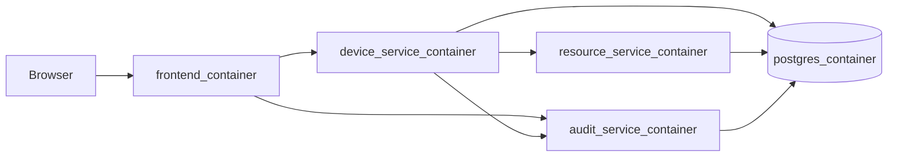

# 第 6 步：容器化 `QYTANG NetDevOps`

## 本步目标

在已经完成本地联调之后，把 `QYTANG NetDevOps` 推进到镜像化阶段。

这一页的重点不是马上发到 Kubernetes，而是先回答下面问题：

- 为什么应用要容器化
- 每个服务的 Dockerfile 放在哪里
- 为什么前端、后端、数据库要分成多个镜像
- `docker compose` 在这里承担什么角色

## 当前已补齐的 Docker 化目录

应用目录下已经有：

- `apps/qytang-netdevops/deploy/docker/frontend/Dockerfile`
- `apps/qytang-netdevops/deploy/docker/device-service/Dockerfile`
- `apps/qytang-netdevops/deploy/docker/resource-service/Dockerfile`
- `apps/qytang-netdevops/deploy/docker/audit-service/Dockerfile`
- `apps/qytang-netdevops/deploy/docker/docker-compose.yaml`

## 为什么这里继续保留 4 个镜像

### 前端镜像

只负责：

- 页面静态文件
- 启动轻量静态服务

### `device-service` 镜像

只负责：

- 设备 CRUD
- Dashboard 聚合

### `resource-service` 镜像

只负责：

- 接口资源查询与统计

### `audit-service` 镜像

只负责：

- 审计日志写入与查询

## 为什么还要有 `docker compose`

`docker compose` 在这一阶段的价值是：

- 帮学员理解“多服务应用如何一起启动”
- 帮学员理解服务名就是服务间访问地址
- 为后面的 Kubernetes 编排建立映射关系

你可以直接告诉学员：

> `docker compose` 是多容器编排的教学过渡层，后面进入 Kubernetes 时，你会发现很多概念是一一对应的。

## 当前 `docker compose` 包含哪些服务

- `postgres`
- `frontend`
- `device-service`
- `resource-service`
- `audit-service`
- `seed-data`

其中：

- `seed-data` 是一次性种子数据服务
- `postgres` 负责把数据库从 SQLite 过渡到更接近生产的 PostgreSQL
- `postgres` 数据通过命名卷 `qytang_netdevops_pgdata` 保留

## 为什么第二阶段改用 PostgreSQL

因为后面的 Helm、Kubernetes 和 GitOps 更适合围绕真实服务拆分来讲。

如果继续让多个容器共享本地 SQLite 文件，会出现很多不适合课堂扩展的问题：

- 讲不清容器之间的数据边界
- 不利于后续上 K8s
- 不利于后续讲持久化与配置注入

所以这里提前改成 `PostgreSQL`，后面课程会更顺。

## 当前持久化状态

这一点现在要明确讲给学员：

- `docker compose` 阶段：PostgreSQL 已使用命名卷持久化
- Kubernetes 阶段：PostgreSQL 已切到 `Longhorn PVC`

这意味着第六章不是只讲“能跑起来”，而是已经具备了继续往状态ful应用教学推进的基础。

## Docker 化后的服务关系图



## 关键教学点

### 教学点 1：Dockerfile 不只是“能跑起来”

你要讲给学员的是：

- 工作目录是什么
- 为什么要复制 `requirements.txt`
- 为什么要设置 `PYTHONPATH`
- 为什么入口命令写成 `uvicorn`

### 教学点 2：Compose 不是 GitOps，但它很重要

因为它帮学员先理解：

- 服务拆分
- 环境变量注入
- 依赖关系
- 端口映射

这些知识在后面的 Kubernetes 和 Argo CD 阶段都会复用。

## 当前验证脚本

```bash
bash /docker_k8s_2026/k8s/06-gitops-and-automation/scripts/04_verify_docker_assets.sh
```

## 下一步

继续看 Git 服务与仓库规划：

- `docs/08_git_service_and_gitea_plan.md`
