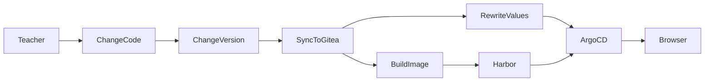

# GitOps 课堂测试与演示

## 本节目标

这一节专门用于课堂现场演示与测试，不再和域名、账户速查混在一起。

本节只关注两类动作：

1. 改代码发布新版本
2. 改 YAML 做声明式扩缩容

## 当前课堂定位

这一节不是在讲新的基础设施，而是在验证第六章前面已经刷通的链路：

- 代码可以同步到 `Gitea`
- 镜像可以推送到 `Harbor`
- `Argo CD` 会自动收敛
- 页面或副本数会按 Git 中目标状态变化

## 演示 A：改代码发布新版本

### 最短动作

这部分现在已经收成课堂最短路径：

1. 改前端代码
2. 只改 `VERSION`
3. 执行脚本

### 推荐修改位置

- `apps/qytang-netdevops/frontend/index.html`
- `apps/qytang-netdevops/frontend/app.js`

### 只改这一个变量

打开：

- `k8s/06-gitops-and-automation/scripts/16_release_frontend_gitops.sh`

只修改：

```bash
VERSION="${VERSION:-v0.1.3}"
```

### 明确不要手工改哪些文件

在“改代码发布”这条演示链路里，不要再手工去改下面 3 个文件：

- `deploy/helm/qytang-netdevops/values.yaml`
- `deploy/helm/qytang-netdevops/values-lab.yaml`
- `deploy/gitops/lab/values-lab.yaml`

原因是：

- `16_release_frontend_gitops.sh` 会自动回写这 3 处前端镜像 tag
- 课堂上只需要改代码，再改 `VERSION`

## !!! 本节必刷脚本

### 改代码发布

```bash
bash /docker_k8s_2026/k8s/06-gitops-and-automation/scripts/16_release_frontend_gitops.sh
```

### 改 YAML 扩缩容

```bash
bash /docker_k8s_2026/k8s/06-gitops-and-automation/scripts/17_scale_frontend_gitops.sh
```

### 这个脚本会自动做什么

它会自动完成下面 7 步：

1. 把应用目录同步到 `Gitea`
2. 到 `git` 节点拉最新代码并构建 `frontend:${VERSION}`
3. 把新镜像 push 到 `Harbor`
4. 自动回写前端镜像 tag
5. 再次同步更新后的应用目录到 `Gitea`
6. 等待 `Argo CD` 同步
7. 输出控制面与页面观察结果

### 当前课堂流程图



### 在哪里观察

可以同时看两个地方：

- `https://argocd.qytk8s.com`
- `https://netdevops.qytk8s.com`

`Argo CD` 中建议重点看：

- `Sync Status`
- `Health Status`
- `Revision`

命令行也可以直接看：

```bash
kubectl -n argocd get application qytang-netdevops -o wide
```

```bash
kubectl -n qytang-netdevops get deploy frontend -o jsonpath='{.spec.template.spec.containers[0].image}{"\n"}'
```

```bash
kubectl -n qytang-netdevops get deploy frontend
```

### 这一段最重要的话

对课堂操作体验来说：

- 你只执行一次脚本

但对 Git 历史来说：

- 当前仍然会形成“源码同步 + values 回写”两次提交

这一点要和“未来 CI 接管后的真正单次 push 流程”区分开。

## 当前实现与理想形态的区别

当前第六章已经真实落地的是：

- 脚本化拆解版 GitOps

也就是：

- 人改代码
- 人执行脚本
- 脚本同步源码
- 脚本构建镜像
- 脚本回写 values
- `Argo CD` 自动同步

更理想的顺滑版流程则是：

- 人只 `push` 一次
- `CI` 自动构建镜像
- `CI` 自动推送 `Harbor`
- `CI` 自动回写 values
- `Argo CD` 自动收敛

## 演示 B：改 YAML 扩缩容

这一段不改代码，不重建镜像，只改目标状态。

### 直接改哪个文件

- `apps/qytang-netdevops/deploy/helm/qytang-netdevops/values-lab.yaml`

### 哪些服务可以改 `replicaCount`

- `frontend`
- `deviceService`
- `resourceService`
- `auditService`

原因：

- 它们都是无状态服务
- 适合用来演示声明式扩缩容

### 哪些服务不要改

- `postgres`

原因：

- 当前是单实例有状态服务
- 使用单 PVC
- 当前模板保持单副本
- 部署策略是 `Recreate`

### 示例

把：

- `frontend.replicaCount: 1`

改成：

```yaml
frontend:
  replicaCount: 2
```

### 观察方法

脚本会等待 `Argo CD` 收敛，并输出：

- `sync`
- `health`
- `frontendDesired`
- `frontendAvailable`

你也可以手工执行：

```bash
kubectl -n qytang-netdevops get deploy frontend device-service resource-service audit-service
```

```bash
kubectl -n qytang-netdevops get pods -o wide
```

## 本节测试通过标准

下面这些满足即可认为课堂测试链路正常：

- `https://argocd.qytk8s.com` 可访问
- `https://netdevops.qytk8s.com` 可访问
- `Application` 为 `Synced / Healthy`
- 可以完成一次“改代码发布”演示
- 可以完成一次“改 YAML 扩缩容”演示

## 常见误区

### 误区 1：运行 `16` 或 `17` 就等于主仓已经自动备份

不是。它们只是把应用目录同步到 `Gitea`，不等于替你自动 `commit/push` 主仓到你的远端。

### 误区 2：扩缩容演示应该去改 GitOps 目录里的 `values-lab.yaml`

当前课堂入口应统一为：

- `deploy/helm/qytang-netdevops/values-lab.yaml`

### 误区 3：`postgres` 也应该一起演示横向扩容

当前不合适。它在本课程环境里是单实例有状态服务。

## 下一步

第六章主线已经完整闭环，后续可以继续进入可观测性与更顺滑的自动化交付演示。
