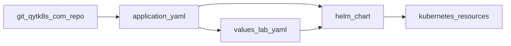

# 第 8 步：Helm 与 Argo CD 目录布局

## 本步目标

在还没有正式安装 Argo CD 之前，先把目录关系讲清楚：

- Helm Chart 放哪里
- `values-lab.yaml` 放哪里
- Argo CD Application 放哪里
- 它们之间如何串起来

## 当前已补齐的目录

### Helm Chart

- `apps/qytang-netdevops/deploy/helm/qytang-netdevops`

### GitOps 环境目录

- `apps/qytang-netdevops/deploy/gitops/lab`

## 当前已补齐的关键文件

### Helm

- `Chart.yaml`
- `values.yaml`
- `templates/namespace.yaml`
- `templates/postgres.yaml`
- `templates/services.yaml`
- `templates/deployments.yaml`

### GitOps

- `deploy/gitops/lab/values-lab.yaml`
- `deploy/gitops/lab/application.yaml`

## 这 3 层分别做什么

### 第 1 层：Chart

Chart 描述“应用一般长什么样”。

也就是：

- 有哪些 Deployment
- 有哪些 Service
- 有哪些数据库与配置对象

### 第 2 层：values

`values-lab.yaml` 描述“实验环境想要什么参数”。

例如：

- 镜像仓库地址
- 镜像标签
- 命名空间
- 副本数

### 第 3 层：Application

Argo CD Application 描述“去哪个 Git 仓库、读哪个目录、把哪些配置同步到哪个命名空间”。

## 目录关系图



## 当前 Application 的教学价值

虽然这一阶段还没有真正安装 Argo CD，但 `application.yaml` 已经能先讲清楚：

- `repoURL`
- `targetRevision`
- `path`
- `destination`
- `syncPolicy`

这样后面真正讲 Argo CD 时，学员不会第一次看到这些字段。

## 关键教学点

### 教学点 1：Helm 不是替代 GitOps

Helm 解决的是“模板化和参数化”问题。

GitOps 解决的是“谁来持续把状态同步到集群”问题。

### 教学点 2：Argo CD 不直接理解你的业务

Argo CD 只理解 Git 里的声明式配置，所以你必须先把：

- 目录结构
- Chart 结构
- values 结构

整理清楚。

## 当前验证脚本

```bash
bash /docker_k8s_2026/k8s/06-gitops-and-automation/scripts/05_verify_gitops_assets.sh
```

## 下一步

进入第六章第二阶段只读验收：

- `docs/10_verify_phase2.md`
