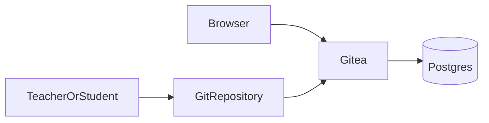

# 第 10 步：安装 Gitea

## 本步目标

在 `git` 节点上部署一套真实可用的 `Gitea`，让 `git.qytk8s.com` 成为第六章后续 GitOps 的事实源入口。

这一步完成后，希望达到下面状态：

- `https://git.qytk8s.com` 可访问
- `git` 节点已经安装 `Docker` 和 `docker compose`
- `Gitea` 与 `PostgreSQL` 容器已经启动
- `Gitea` 使用 HTTPS
- 已创建管理员账号

## 为什么第六章要自己部署 Git 服务

如果课堂里直接用公网 Git 平台，虽然也能讲 GitOps，但会失去很多“整套环境自洽”的价值。

自己部署 `Gitea` 有 4 个教学优势：

- 让学员理解 GitOps 的 Git 服务也是基础设施的一部分
- 让整条交付链路都在课程环境中闭环
- 后续可直接和 `Argo CD`、`Harbor` 串起来
- 更接近真实企业内部环境

## 当前固定参数

- Git 节点：`git`
- Git IP：`10.1.1.202`
- Git 域名：`git.qytk8s.com`
- Gitea 版本：`1.25.4`
- 管理员用户：`gitadmin`
- 管理员密码：`Gitea12345`

## 证书设计说明

这一章不单独再建一套 CA，而是继续复用第一章 Harbor 已使用的内部 CA。

这样做的好处是：

- 浏览器和客户端只要信任一套 CA
- 后续 `git.qytk8s.com`、`argocd.qytk8s.com` 可以继续复用同一信任链
- 课堂讲证书时更容易讲清楚“企业内部统一 CA”的思路

## Gitea 组件关系图



## 本步脚本

- `k8s/06-gitops-and-automation/scripts/07_install_gitea_remote.sh`

## 执行命令

```bash
chmod +x /docker_k8s_2026/k8s/06-gitops-and-automation/scripts/07_install_gitea_remote.sh
```

```bash
bash /docker_k8s_2026/k8s/06-gitops-and-automation/scripts/07_install_gitea_remote.sh
```

## 脚本会做什么

1. 检查 Harbor CA
2. 为 `git.qytk8s.com` 签发服务端证书
3. 生成 Gitea 的 `docker compose` 文件
4. 将证书和 compose 下发到 `git` 节点
5. 在 `git` 节点安装 `docker.io` 和 `docker-compose-v2`
6. 启动 `Gitea` 与 `PostgreSQL`
7. 创建管理员用户

## 执行后的验证

### 验证 1：访问首页

```bash
curl --cacert /docker_k8s_2026/k8s/01-k8s-architecture/pki/harbor/harbor-ca.crt -I https://git.qytk8s.com
```

### 验证 2：查看版本接口

```bash
curl --cacert /docker_k8s_2026/k8s/01-k8s-architecture/pki/harbor/harbor-ca.crt https://git.qytk8s.com/api/v1/version
```

### 验证 3：浏览器访问

在 `win2019` 浏览器中访问：

- `https://git.qytk8s.com`

账号：

- 用户名：`gitadmin`
- 密码：`Gitea12345`

## 本步完成标准

- `https://git.qytk8s.com` 可访问
- `gitadmin` 可登录
- `Gitea` 与 `PostgreSQL` 容器正常

## 下一步

继续创建应用仓库：

- `docs/12_prepare_gitea_repo_and_push.md`
