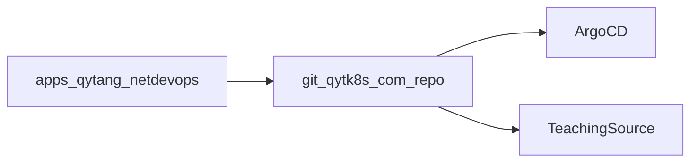

# 第 11 步：创建仓库并准备首推

## 本步目标

在 `Gitea` 中创建 `QYTANG NetDevOps` 仓库，为后续 Helm、GitOps 和 Argo CD 做准备。

## 为什么这一步很关键

很多学员以为 GitOps 的重点只是“安装 Argo CD”，其实不是。

GitOps 的真正关键，是你必须先有一个结构清晰、目录规范、可以承载：

- 源码
- Dockerfile
- Helm Chart
- GitOps 环境目录

的 Git 仓库。

所以这一步本质上是在准备“事实源”。

## 推荐仓库名

- `qytang-netdevops.git`

## 当前推荐的远端地址

- `https://git.qytk8s.com/gitadmin/qytang-netdevops.git`

## 当前本地目录

- `apps/qytang-netdevops`

## 仓库结构为什么适合 GitOps

因为它已经具备：

- `frontend/`
- `backend/`
- `deploy/docker/`
- `deploy/helm/`
- `deploy/gitops/`
- `scripts/`

这一点要讲给学员：

> GitOps 不是只要求“有个 Git 仓库”，而是要求仓库结构本身足够工程化。

## 本步脚本

- `k8s/06-gitops-and-automation/scripts/08_create_gitea_repo.sh`

## 执行命令

```bash
chmod +x /docker_k8s_2026/k8s/06-gitops-and-automation/scripts/08_create_gitea_repo.sh
```

```bash
bash /docker_k8s_2026/k8s/06-gitops-and-automation/scripts/08_create_gitea_repo.sh
```

## 当前阶段为什么先只创建仓库

因为这一阶段要先把“仓库存在”这件事讲清楚。

后面真正做首次推送时，可以继续扩展讲：

- `git init`
- `git remote add`
- `git add`
- `git commit`
- `git push`

这部分更适合放在 Argo CD 前面一起讲。

## 课堂图示



## 下一步

继续验证 Gitea 与仓库环境：

- `docs/13_verify_gitea.md`
