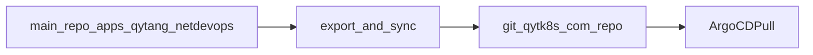

# 第 13 步：把 QYTANG NetDevOps 首推到 Gitea

## 本步目标

把主仓中的 `apps/qytang-netdevops` 目录导出并同步到：

- `https://git.qytk8s.com/gitadmin/qytang-netdevops.git`

## 为什么这一步必须单独讲

很多学员会把 GitOps 理解成：

> Helm Chart 放到 Git 里，然后 Argo CD 去拉。

这句话没有错，但还不完整。

真正要讲透的是：

- 主仓必须保留应用目录的完整真实源码
- 这样主仓 `git push` 才能真正完成备份
- 第六章脚本再把这个目录同步到 Gitea，作为 Argo CD 的拉取目标

## 课堂图示



## 本步脚本

- `scripts/10_push_qytang_netdevops_repo.sh`

## 执行命令

```bash
chmod +x /docker_k8s_2026/k8s/06-gitops-and-automation/scripts/10_push_qytang_netdevops_repo.sh
```

```bash
bash /docker_k8s_2026/k8s/06-gitops-and-automation/scripts/10_push_qytang_netdevops_repo.sh
```

## 讲课要点

- 总工程负责统一维护和真正备份课程素材
- Gitea 负责作为 GitOps 交付目标
- 这里采用“主仓真实保存 + 脚本同步到 Gitea”的方式，避免子模块或嵌套仓库带来的恢复风险

## 下一步

继续把 Git 仓库里的源码构建为镜像并推送到 Harbor：

- `docs/15_build_and_push_images.md`
