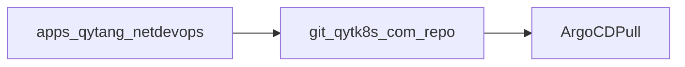

# 第 13 步：把 QYTANG NetDevOps 首推到 Gitea

## 本步目标

把 `apps/qytang-netdevops` 初始化为独立仓库，并首推到：

- `https://git.qytk8s.com/gitadmin/qytang-netdevops.git`

## 为什么这一步必须单独讲

很多学员会把 GitOps 理解成：

> Helm Chart 放到 Git 里，然后 Argo CD 去拉。

这句话没有错，但还不完整。

真正要讲透的是：

- 本地应用目录可以继续留在总工程里维护
- 但它必须具备独立 `.git` 历史
- 这样它才能成为一个真正的“交付事实源”

## 课堂图示



## 本步脚本

- `scripts/10_push_qytang_netdevops_repo.sh`

## 执行命令

```bash
chmod +x /docker_k8s_2026/k8s/06-gitops-and-automation/scripts/10_push_qytang_netdevops_repo.sh
```

```bash
bash /docker_k8s_2026/k8s/06-gitops-and-automation/scripts/10_push_qytang_netdevops_repo.sh
```

## 讲课要点

- 总工程负责统一维护课程素材
- 子目录仓库负责独立交付与独立 push
- 这是很多企业单仓/多仓混合模式的真实缩影

## 下一步

继续把 Git 仓库里的源码构建为镜像并推送到 Harbor：

- `docs/15_build_and_push_images.md`
