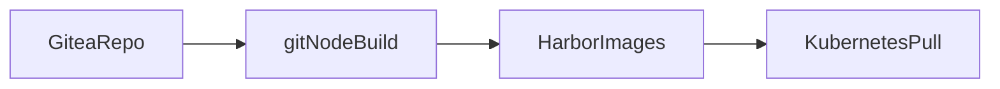

# 第 14 步：构建并推送镜像到 Harbor

## 本步目标

把 `QYTANG NetDevOps` 的四个镜像推送到：

- `harbor.qytk8s.com/qytang-netdevops/frontend:v0.1.0`
- `harbor.qytk8s.com/qytang-netdevops/device-service:v0.1.0`
- `harbor.qytk8s.com/qytang-netdevops/resource-service:v0.1.0`
- `harbor.qytk8s.com/qytang-netdevops/audit-service:v0.1.0`

当前课堂最新已验证版本：

- `harbor.qytk8s.com/qytang-netdevops/frontend:v0.1.2`

## 为什么这里不直接在 ops 构建

当前课程环境里，`ops` 负责：

- 文档讲解
- `kubectl`
- 本地联调

而 `git` 节点已经安装好 Docker，因此这一版教材采用：

- `ops` 发起命令
- `git` 节点远程构建
- 推送到 Harbor

这条链路更接近很多企业里的“专用构建机”思路。

## 课堂图示



## 本步脚本

- `scripts/11_build_and_push_images_remote.sh`

## 执行命令

```bash
chmod +x /docker_k8s_2026/k8s/06-gitops-and-automation/scripts/11_build_and_push_images_remote.sh
```

```bash
bash /docker_k8s_2026/k8s/06-gitops-and-automation/scripts/11_build_and_push_images_remote.sh
```

## 课堂要强调的点

- Git 存的是声明与源码，不是运行时容器
- Kubernetes 拉的是镜像，不是 Git 源码
- Argo CD 同步的是清单，不负责编译你的 Python 代码

## 下一步

安装 Argo CD，并让它从 Gitea 自动同步到集群：

- `docs/16_install_argocd_and_sync.md`
