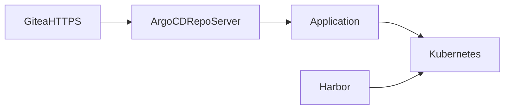

# 第 15 步：安装 Argo CD 并同步应用

## 本步目标

完成三件事：

1. 在集群中安装 `Argo CD`
2. 让 `Argo CD` 信任 `git.qytk8s.com` 的证书
3. 创建 `qytang-netdevops` Application 并自动同步

## 为什么一定要补“证书信任”

这一点特别适合上课讲。

很多实验环境里，学员会遇到：

- Git 仓库是自签发证书
- 浏览器能打开
- 但 Argo CD repo-server 拉仓库失败

根因通常不是 Git 地址错了，而是：

> repo-server 不信任 Git 服务器证书链

所以这一步不仅是安装 Argo CD，更是在补齐“企业内网 GitOps 常见障碍”。

## 课堂图示



## 本步脚本

- `scripts/12_install_argocd_and_sync.sh`

## 执行命令

```bash
chmod +x /docker_k8s_2026/k8s/06-gitops-and-automation/scripts/12_install_argocd_and_sync.sh
```

```bash
bash /docker_k8s_2026/k8s/06-gitops-and-automation/scripts/12_install_argocd_and_sync.sh
```

## 课堂要讲的观察点

- `argocd-server` 是否获得了 `LoadBalancer VIP`
- `Application` 的 `sync.status` 是否为 `Synced`
- `Application` 的 `health.status` 是否为 `Healthy`
- `frontend` 是否获得了独立 VIP

## 当前实际结果

当前环境已经完成：

- `argocd-server` VIP：`10.1.1.50`
- `Argo CD` 正式域名：`https://argocd.qytk8s.com`
- `QYTANG NetDevOps` 最终业务入口会继续收口到 `https://netdevops.qytk8s.com`

## 下一步

做端到端验收，确认 Git、Harbor、Argo CD、业务入口全通：

- `docs/17_verify_gitops_e2e.md`
