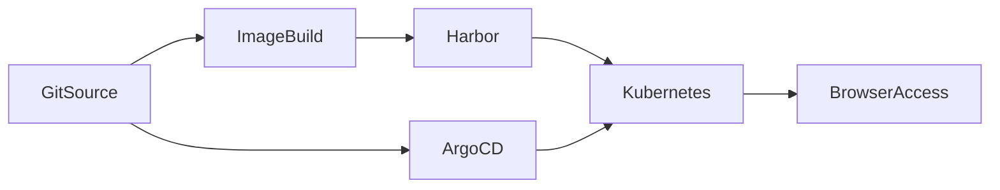

# 第 16 步：验证 GitOps 端到端链路

## 本步目标

确认下面链路已经闭环：

- `Gitea` 有仓库
- `Harbor` 有镜像
- `Argo CD` 能同步
- `Kubernetes` 里 Pod 正常
- 前端 Service 已能正确返回业务数据

## 端到端关系图



## 本步脚本

- `scripts/13_verify_gitops_e2e.sh`

## 执行命令

```bash
chmod +x /docker_k8s_2026/k8s/06-gitops-and-automation/scripts/13_verify_gitops_e2e.sh
```

```bash
bash /docker_k8s_2026/k8s/06-gitops-and-automation/scripts/13_verify_gitops_e2e.sh
```

## 当前环境验收结论

当前已经验证通过：

- `Application` 状态为 `Synced Healthy`
- `https://argocd.qytk8s.com` 可访问 Argo CD
- 前端 Service 可返回 dashboard 数据

## Argo CD 当前登录信息

- 用户名：`admin`
- 默认密码：`Cisc0123`

## 当前域名与映射

- `git.qytk8s.com -> 10.1.1.202`
- `argocd.qytk8s.com -> 10.1.1.50`

## 当前闭环与后续推荐流程

这一页验证通过的，是第六章当前已落地的拆解版流程：

- 手工改代码
- 手工构建镜像
- 手工改 Git 中的镜像 tag
- `Argo CD` 自动同步
- 通过前端 Service 验证应用已经真正可用

这说明当前环境已经具备完整 GitOps 教学基础。

后续更推荐的工程化表达是：

- 人只 `push` 一次
- `Git` 触发 `CI`
- `CI` 自动构建镜像并回写 `values`
- `Argo CD` 按 Git 最终状态发布

也就是说：

- 当前这一页证明“链路已经通了”
- 后续顺滑版只是把中间机械动作继续交给 `CI`

## 课堂建议

这一页非常适合收尾时强调一句：

> GitOps 的重点不是“把 YAML 放进 Git”，而是把源码、镜像、清单和集群状态真正打通。

## 下一步

下一步再把业务入口正式发布为 `https://netdevops.qytk8s.com`。

- `docs/18_publish_netdevops_domain.md`
