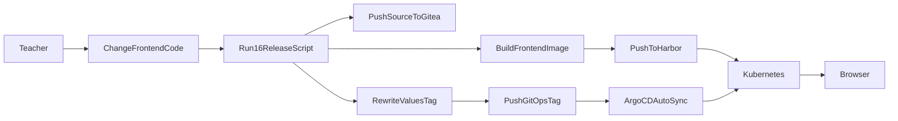
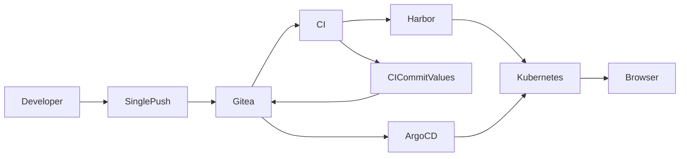

# 第 21 步：GitOps 测试手册

## 本页目标

这一页不再只讲概念，而是直接给出课堂可执行动作。

你现在只需要记住两件事：

1. 改代码发布，用 `scripts/16_release_frontend_gitops.sh`
2. 改 yaml 扩缩容，用 `scripts/17_scale_frontend_gitops.sh`

## 当前课堂最推荐操作法

你前面提的问题，本质上是这几个点：

1. 我只想改具体代码
2. 我不想自己再去手改 3 个 `values` 文件
3. 我希望只改一个版本变量
4. 我执行一个脚本后，Git、Harbor、Argo CD、页面结果都串起来

所以现在第六章这一段，课堂上就按下面这个操作方式：

- 你改应用代码
- 你只改脚本里的 `VERSION`
- 你执行脚本
- 脚本自动把主仓中的应用目录同步到 Gitea，再完成构建镜像、推镜像、回写 tag、再次同步、等待 Argo CD 同步

也就是说，老师上课时不需要再手打一长串命令。

## 演示 A：改代码发布新版本

### 改哪里

课堂上最推荐改前端页面文字，因为最容易看出变化。

优先改这些文件：

- `apps/qytang-netdevops/frontend/index.html`
- `apps/qytang-netdevops/frontend/app.js`

最推荐第一次只改：

- 页面标题
- 页面副标题
- 某一段中文提示语

### 只改哪个变量

不要再手工改：

- `deploy/helm/qytang-netdevops/values.yaml`
- `deploy/helm/qytang-netdevops/values-lab.yaml`
- `deploy/gitops/lab/values-lab.yaml`

这些现在由脚本自动改。

你只需要打开：

- `k8s/06-gitops-and-automation/scripts/16_release_frontend_gitops.sh`

然后只改这一个变量：

```bash
VERSION="${VERSION:-v0.1.1}"
```

说明如下：

- `VERSION`：新镜像版本，例如 `v0.1.2`

其他提交说明、校验文字这些内容都已经写死在脚本内部，课堂上不用改。

### 一次执行的命令

```bash
bash /docker_k8s_2026/k8s/06-gitops-and-automation/scripts/16_release_frontend_gitops.sh
```

### 这个脚本会自动做什么

脚本会自动完成下面 7 步：

1. 把你当前改过的应用代码同步到 `git.qytk8s.com`
2. 到 `git` 节点拉最新代码并构建 `frontend:${VERSION}`
3. 把新镜像 push 到 `Harbor`
4. 自动把 3 个 `values` 文件中的前端 tag 改成 `${VERSION}`
5. 自动把新的 values 内容再次同步到 Gitea
6. 等待 `Argo CD` 同步
7. 输出 Argo CD 与页面观察结果

### 当前脚本化流程图



### 在哪里看 Argo CD

脚本执行过程中，会持续打印：

- `sync`
- `health`
- `image`

你还可以手工打开：

- `https://argocd.qytk8s.com`

登录信息：

- `admin / Cisc0123`

找到应用：

- `qytang-netdevops`

重点看这 3 个字段：

- `Sync Status`
- `Health Status`
- `Revision`

预期结果：

- `Synced`
- `Healthy`
- `Revision` 变成最新提交

### 在哪里看最终页面变化

脚本最后会输出：

- `https://netdevops.qytk8s.com`

脚本会自动输出页面访问结果，你直接刷新浏览器页面确认变化即可。

### 老师上课时最短动作

1. 改 `apps/qytang-netdevops/frontend/index.html`
2. 改 `scripts/16_release_frontend_gitops.sh` 里的 `VERSION`
3. 执行脚本
4. 打开 `https://argocd.qytk8s.com`
5. 打开 `https://netdevops.qytk8s.com`

### 这里为什么不会再把源码弄丢

这一版脚本要强调一个关键边界：

- `apps/qytang-netdevops` 现在是主仓普通目录
- 主仓负责真正备份源码
- Gitea 只负责第六章 GitOps 演示发布

所以：

- 主仓 `git push` 成功，源码就一定被备份
- `16` 和 `17` 脚本只是把这个目录同步到 Gitea，不再要求应用目录自己带独立 `.git`

## 演示 B：改 yaml 扩缩容

这一段不改代码，不重建镜像，只改目标状态。

### 直接改哪个 yaml

你现在直接改这个文件：

- `apps/qytang-netdevops/deploy/helm/qytang-netdevops/values-lab.yaml`

### 哪些服务可以改 `replicaCount`

这几个业务服务可以改：

- `frontend.replicaCount`
- `deviceService.replicaCount`
- `resourceService.replicaCount`
- `auditService.replicaCount`

原因很简单：

- 它们都是无状态服务
- 适合用多副本做课堂演示

### 哪些不要改 `replicaCount`

当前不要改：

- `postgres`

原因是：

- 它是单实例有状态服务
- 当前模板里固定为 `replicas: 1`
- 使用的是单 `PVC`
- 部署策略是 `Recreate`

所以 PostgreSQL 这一段，课堂上保持单副本即可，不要拿它做横向扩容演示。

### 例子

例如把：

- `frontend.replicaCount: 1`

改成：

```yaml
frontend:
  replicaCount: 2
```

### 一次执行的命令

```bash
bash /docker_k8s_2026/k8s/06-gitops-and-automation/scripts/17_scale_frontend_gitops.sh
```

### 这个脚本会自动做什么

它会自动完成：

1. 检查你是否已经手工修改了 `values.yaml` 或 `values-lab.yaml`
2. 提交并 push 这些 values 变更到 `Gitea`
3. 等待 `Argo CD` 自动同步
4. 输出 `frontend`、`device-service`、`resource-service`、`audit-service` 的 Deployment 状态

### 你会看到什么

命令行里会直接看到：

- `sync=Synced`
- `health=Healthy`
- `frontendDesired=...`
- `frontendAvailable=...`

同时也可以执行：

如果这次是一次性调整多个业务服务的副本数，直接一次性检查全部业务 Deployment：

```bash
kubectl -n qytang-netdevops get deploy frontend device-service resource-service audit-service
```

如果要继续看业务 Pod 分布，也可以一次性查看：

```bash
kubectl -n qytang-netdevops get pods -o wide
```

这里课堂上重点只看 4 个业务服务：

- `frontend`
- `device-service`
- `resource-service`
- `audit-service`

PostgreSQL 不参与这里的扩缩容演示，不需要一起检查副本数。

## 现在到底是不是“只 push 一次”

### 对老师的操作体验来说

现在已经接近“只操作一次”了。

因为你只需要：

1. 改代码
2. 改脚本里的 `VERSION`
3. 执行一次脚本

### 但对 Git 历史来说

当前脚本化方案仍然是：

- 一次源码提交
- 一次 `values` 回写提交

也就是说：

- 对老师来说：只执行一次脚本
- 对 Git 来说：仍然会有两次提交

这正是第六章当前已经落地的“拆解版 GitOps”。

## 后续推荐的顺滑版流程

后续如果要完全收口成你说的那种：

> 我只改代码，然后只 push 一次，后面全自动

那就需要把当前 `16_release_frontend_gitops.sh` 里这几段动作迁移到 `CI`：

- 构建镜像
- 推送镜像
- 回写 `values`
- 自动提交 GitOps tag

### 推荐顺滑流程图



所以这一页的课堂话术建议是：

- 第六章当前已经真实跑通的是“脚本化拆解版”
- 老师只需要执行一次脚本
- 但 Git 历史里仍然能看到“源码提交 + values 提交”
- 后续再把这部分平移到 `CI`，就会变成真正的人只 `push` 一次

## 命令行观察补充

如果你不看网页，也可以直接看命令行：

```bash
kubectl -n argocd get application qytang-netdevops -o wide
```

```bash
kubectl -n qytang-netdevops get deploy frontend -o jsonpath='{.spec.template.spec.containers[0].image}{"\n"}'
```

```bash
kubectl -n qytang-netdevops get deploy frontend
```

## 数据库持久化当前状态

这一点已经收口清楚：

- `docker compose` 使用命名卷 `qytang_netdevops_pgdata`
- Kubernetes 使用 `Longhorn PVC`

也就是说：

- 普通业务 Pod 重启，不会丢 PostgreSQL 数据
- 第六章已经具备继续做有状态演示的基础
