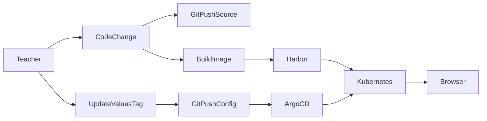
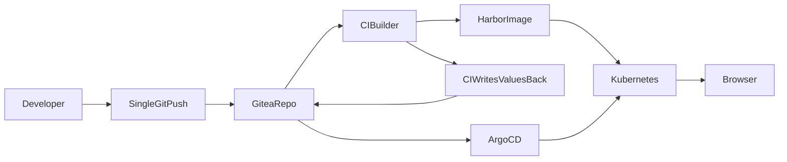

# 第 20 步：GitOps 测试手册

## 本页目标

这一页专门回答 5 个课堂问题：

1. 在哪改 app
2. 怎么 push
3. 版本号怎么处理
4. Argo CD 在哪里看 GitOps
5. 为什么顺滑版流程里，人只需要 push 一次

## 本页先讲清楚一个边界

第六章当前已经真实跑通的是：

- 手工拆解版 GitOps 演示
- 也就是把“改代码、构建镜像、改 values、Argo 同步”拆开讲

这样做的目的，是先让学员看清楚每一层在做什么。

第六章后续更推荐的工程化表达是：

- 人只 `push` 一次
- `Git` 触发 `CI`
- `CI` 自动构建镜像并推送到 `Harbor`
- `CI` 自动回写 `values`
- `Argo CD` 按 Git 最终状态同步

所以这一页会同时保留两部分：

- `当前已落地演示`
- `推荐顺滑流程`

## 两种 GitOps 演示

这一页建议老师现场做两段：

- 演示 A：改代码并发布新镜像
- 演示 B：直接改 yaml 做扩缩容

这样学员能同时理解：

- GitOps 可以发布新代码
- GitOps 也可以只改目标状态声明

## 当前已落地演示

### 演示 A：改代码发布

这一段是当前环境已经真实验证过的流程。

#### 在哪改 app

最适合课堂演示的改动位置：

- 页面标题：`apps/qytang-netdevops/frontend/index.html`
- 页面文案：`apps/qytang-netdevops/frontend/index.html`
- 前端逻辑：`apps/qytang-netdevops/frontend/app.js`

建议不要第一次就改后端逻辑，前端文字最容易在课堂上看出变化。

#### 版本号怎么处理

当前前端已验证版本：

- `frontend:v0.1.2`

下一次课堂演示可继续递增：

- `frontend:v0.1.3`

这里要强调：

- 改代码本身不会自动让 Kubernetes 更新
- 必须有一个新的镜像版本
- Git 里还要把 Helm values 改到这个新 tag

#### 当前落地流程

1. 改源码
2. 提交源码到 `Gitea`
3. 构建并推送镜像到 `Harbor`
4. 修改 Git 中的镜像 tag
5. 再提交一次到 `Gitea`
6. `Argo CD` 自动同步
7. 页面出现新效果

#### 当前为什么不够丝滑

因为老师要手工做两类动作：

- 一类是代码和镜像
- 一类是配置和 tag

这对“拆解教学”很有价值，但不够像真正的工程流。

#### 当前流程示意图



### 演示 B：改 yaml 扩缩容

这一段不改代码，不重新构建镜像，直接改目标状态。

最适合第一次演示的字段：

- `frontend.replicaCount`
- `deviceService.replicaCount`
- `resourceService.replicaCount`
- `auditService.replicaCount`

例如把：

- `apps/qytang-netdevops/deploy/helm/qytang-netdevops/values.yaml`

中的：

- `frontend.replicaCount: 1`

改成：

- `frontend.replicaCount: 2`

如果课堂上要保持 lab 环境一致，建议这两个文件一起改：

- `apps/qytang-netdevops/deploy/helm/qytang-netdevops/values.yaml`
- `apps/qytang-netdevops/deploy/helm/qytang-netdevops/values-lab.yaml`

#### 当前落地特点

- 不需要重新 build 镜像
- 不需要手工 `kubectl scale`
- `Argo CD` 会自动把副本数收敛到 Git 中声明的值

## 推荐顺滑流程

### 目标表达

推荐最终把第六章 GitOps 收口成这句话：

> 人只 push 一次，CI 补全镜像构建和 values 回写，Argo CD 按 Git 最终状态发布。

### 为什么这仍然是“Git 决定一切”

因为最终进入集群的，不是“Harbor 里碰巧出现的新镜像”，而是：

- `CI` 把新镜像 tag 写回 Git
- `Argo CD` 再按 Git 中新的目标状态去同步

所以最终事实源仍然是 Git，不是镜像仓库。

### 为什么看起来像两次提交

这里最容易把学员讲晕，所以要单独强调：

- 人只手工 `push` 一次
- 但 CI 会自动产生第二次提交

这第二次提交的作用，是把：

- 新镜像 tag
- 新的目标状态

写回 Git。

所以：

- 从“人”的体验看：只 push 一次
- 从“Git 历史”看：通常会看到 CI 补的一次提交

### 推荐顺滑流程图



### 这条顺滑流程能覆盖什么

- 改代码发布新版本
- 改 yaml 做扩缩容
- 改资源限制
- 改副本数
- 改配置参数

区别只是：

- 改代码时，需要 CI 构建新镜像
- 改 yaml 时，不需要新镜像，只需要 Git 变更

## 当前课堂怎么讲最顺

建议课堂按下面顺序讲：

1. 先演示当前已落地的拆解版流程
2. 再给出顺滑版流程图
3. 再告诉学员：真实生产里通常会继续把“构建镜像和回写 values”交给 CI

这样既不会失真，也不会让学员觉得当前环境不够完整。

## Argo CD 如何看 GitOps

不需要额外手工部署，不需要重新 `kubectl apply`。

因为当前 `Application` 已经开启：

- 自动同步
- 自动自愈

### 看网页

- 打开：`https://argocd.qytk8s.com`
- 账号：`admin / Cisc0123`
- 找到应用：`qytang-netdevops`

重点看：

- `Sync Status`
- `Health Status`
- `Revision`

预期是：

- `Synced`
- `Healthy`
- revision 变成最新提交

### 看命令行

```bash
kubectl -n argocd get application qytang-netdevops -o wide
```

```bash
kubectl -n qytang-netdevops get deploy frontend -o jsonpath='{.spec.template.spec.containers[0].image}{"\n"}'
```

```bash
kubectl -n qytang-netdevops get deploy frontend
```

### 看页面效果

打开：

- `https://netdevops.qytk8s.com`

如果页面出现你刚改的新文字，说明“改代码发布”闭环了。

如果 `frontend` Deployment 的副本数变成 2，说明“改 yaml 扩缩容”闭环了。

## 数据库持久化现在是什么状态

这一点现在已经收口清楚：

- `docker compose`：使用命名卷 `qytang_netdevops_pgdata`
- Kubernetes：使用 `Longhorn PVC`

也就是说：

- 重启普通业务 Pod，不会丢 PostgreSQL 数据
- 第六章已经具备“可继续扩展状态ful演示”的基础

## 课堂建议

第一次演示时，优先改：

- 页面标题
- 首页副标题
- 某一段中文提示语

因为这种变化最容易让学员一眼看到“GitOps 真的生效了”。

第二次演示时，再补一个：

- `frontend.replicaCount: 1 -> 2`

这样学员就能立刻理解：

- 改代码是 GitOps
- 改声明也是 GitOps
- 顺滑版的关键不是少掉 Git，而是把中间机械动作交给 CI
