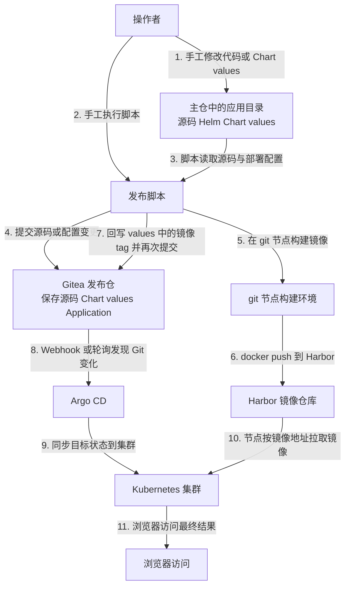
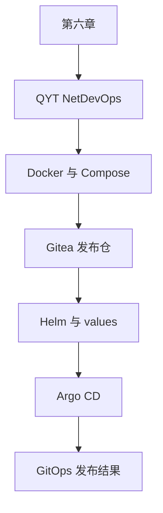

# 第六章总览：GitOps 主线与交付边界

## 本节目标

完成这一节后，你应该能明确下面 4 件事：

1. 第六章到底在解决什么问题。
2. `QYT NetDevOps` 为什么适合作为 GitOps 教学样板。
3. 当前第六章已经真实落地的 GitOps 流程是什么。
4. 主仓、`Gitea`、`Harbor`、`Argo CD` 分别扮演什么角色。

## 为什么第六章要这样讲

前五章的重点是平台能力：

- 集群
- 网络
- 存储
- 安全
- 网关

第六章开始，重点切换为：

- 应用如何进入集群
- 版本如何被持续交付
- 目标状态如何由 Git 驱动

所以这一章不能只讲某个工具怎么安装，而必须讲清楚一条完整链路：

这一页不再重复解释 `GitOps`、`Helm`、`values.yaml`、`Argo CD` 的基础定义。

这些基础概念已经在上一页 [00_gitops_theory.md](/docker_k8s_2026/k8s/06-gitops-and-automation/docs/00_gitops_theory.md) 里集中说明。

从这一页开始，重点改成：

- 第六章为什么这样展开
- 为什么要选 `QYT NetDevOps`
- 当前主仓、发布仓、镜像仓库和集群之间怎么配合
- 这条主线在课堂里到底会走到什么程度

### 为什么要先用样板应用承载这一章

如果只讲 YAML、Chart、Application，学员看到的是一堆抽象配置。

而 `QYT NetDevOps` 这个样板应用能把交付对象变得具体：

- 有前端页面
- 有设备服务、资源服务、审计服务
- 有数据库
- 有后续可观测性扩展空间

所以第六章不是“先讲 Argo CD，再找个应用凑进去”，而是“先有一个可见应用，再把它一步一步推进到 GitOps”。

## 当前真实落地的 GitOps 形态

这一章当前已经真实跑通的是：

- 手工改代码
- 手工触发脚本
- 脚本同步源码到 `Gitea`
- 脚本构建镜像并推送到 `Harbor`
- 脚本回写 Git 中的镜像 tag
- `Argo CD` 自动同步到集群

这是一种“脚本化拆解版 GitOps”。

它的优点是：

- 教学路径清楚
- 每一步都能观察
- 学员容易理解源码、镜像、配置、集群状态之间的关系

但这一章当前还不是：

- 人只 `push` 一次
- `CI` 自动构建并回写
- 完整企业流水线版本

## 当前仓库边界

这一章现在最重要的边界如下：

- 主仓：`/docker_k8s_2026`
- 应用目录：`/docker_k8s_2026/apps/qytang-netdevops`
- GitOps 发布仓：`https://git.qytk8s.com/gitadmin/qytang-netdevops.git`

这里要特别强调：

- 主仓才是真正的源码维护与备份边界
- `apps/qytang-netdevops` 只是主仓中的普通目录
- `Gitea` 中的 `qytang-netdevops` 仓库是第六章 GitOps 发布目标

也就是说：

- 你在主仓里维护代码
- 你通过脚本把应用目录同步到 `Gitea`
- `Argo CD` 再从 `Gitea` 拉取状态

## 课堂统一关系图

## 本节完成标准

满足下面条件即可进入下一节：

- 已理解第六章不是“装工具”，而是“打通交付链路”
- 已理解主仓、`Gitea`、`Harbor`、`Argo CD` 的角色分工
- 已理解当前真实落地的是“脚本化拆解版 GitOps”
- 已理解当前第六章主线的边界与落地方式

## 下一步

进入样板应用本身，先把应用设计、本地联调与工程化资产彻底讲清楚：

- `docs/02_app_design_and_local_preview.md`
