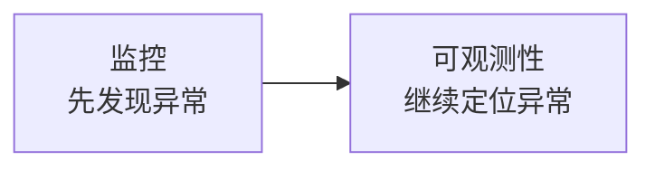
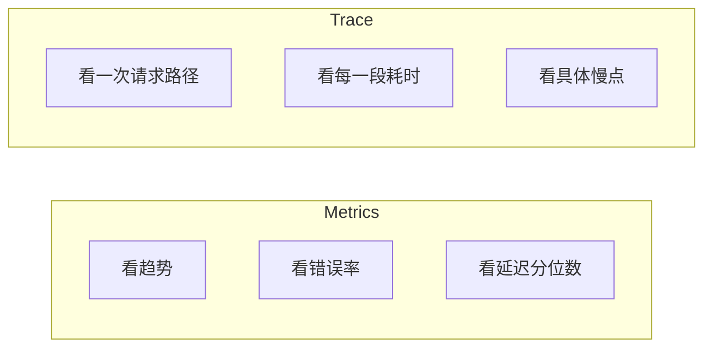
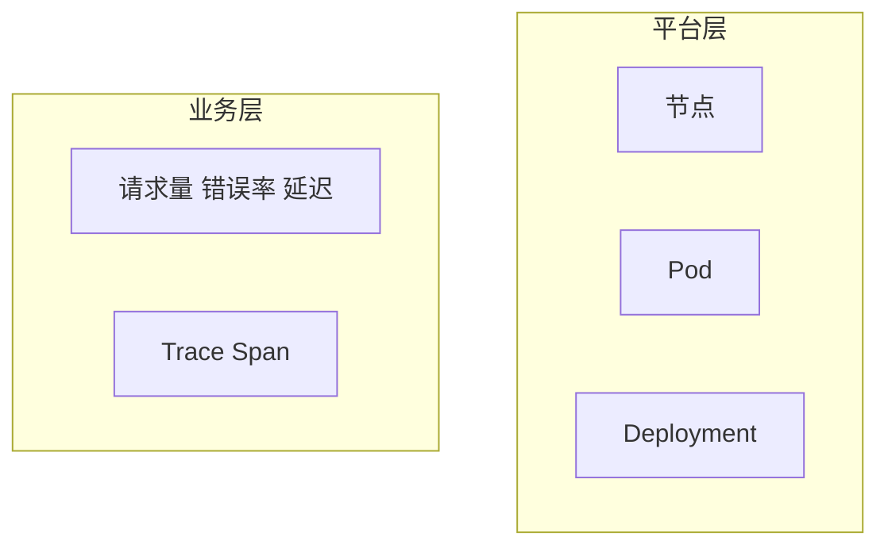
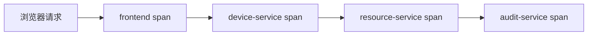
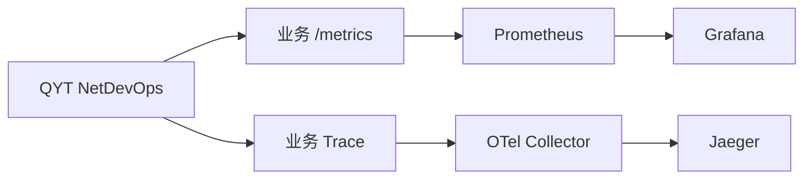
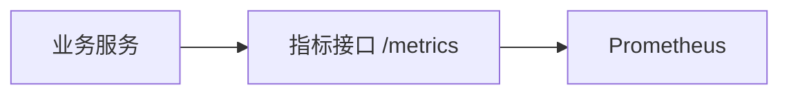
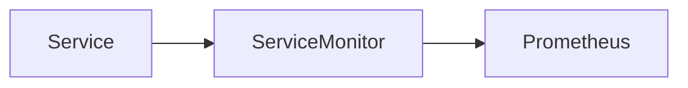
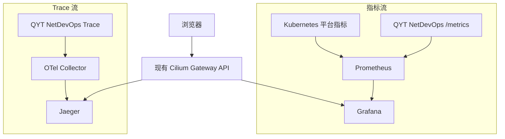

# 第七章理论：可观测性、指标与分布式 Trace

## 本节目标

完成这一节后，应该先建立下面几个最基础的认识：

- 什么是可观测性
- `Metrics` 和 `Trace` 分别解决什么问题
- Kubernetes 指标、业务指标、业务 Trace 分别看什么
- `Prometheus`、`Grafana`、`Jaeger`、`OpenTelemetry Collector` 各自做什么
- 第七章要打通的完整数据流是什么

## 什么是可观测性

可观测性可以先记成一句最短的话：

**当系统出现异常时，能够凭借已有数据快速知道“发生了什么、问题在哪里”。**

到第六章结束时，你已经能回答：

- 应用能不能发布成功
- 域名能不能访问
- Pod 有没有跑起来

但你还不能稳定回答：

- 哪个节点资源紧张
- 哪个服务请求量突然升高
- 哪个接口延迟变大
- 某一次真实请求到底慢在哪个服务

这正是第七章要解决的问题。

## 监控和可观测性的区别

这两个词很像，但不要混在一起。

- `监控`
  - 更偏“持续看状态”
  - 例如：
    - CPU 是否过高
    - Pod 是否重启
    - 接口错误率是否升高
- `可观测性`
  - 更偏“出现异常后能不能快速定位原因”
  - 例如：
    - 到底是哪个服务慢
    - 慢在服务调用、数据库还是下游接口

可以先记成一句最短的话：

- `监控` 负责先发现异常
- `可观测性` 负责继续定位异常



## Metrics 和 Trace 的区别

### Metrics 适合回答什么

- 当前 CPU、内存、磁盘、网络趋势如何
- 某个服务 QPS 是否升高
- 某个接口错误率是否升高
- P95、P99 延迟是否变差

### Trace 适合回答什么

- 某一次请求具体经过了哪些服务
- 哪一段调用最慢
- 哪个 span 报错
- 上游慢还是下游慢



这张图表达的核心是：

- `Metrics` 更适合先发现异常
- `Trace` 更适合再定位异常

## 先把几个最容易卡住的新词讲清楚

### QPS 是什么

`QPS` 可以先理解成：

**每秒处理多少个请求。**

如果某个服务平时只有 `20 QPS`，突然变成 `500 QPS`，通常就说明流量明显升高了。

### 错误率是什么

错误率可以先理解成：

**所有请求里，失败请求占了多少比例。**

如果错误率突然升高，往往说明接口、下游依赖或资源已经出现问题。

### P95 / P99 是什么

这两个词第一次看最容易懵。

可以先简单记成：

- `P95`
  - 100 次请求里，大约 95 次都不会慢过这个值
- `P99`
  - 100 次请求里，大约 99 次都不会慢过这个值

所以：

- 平均值适合看整体大概情况
- `P95 / P99` 更适合看“尾部慢请求”有没有变严重

## Kubernetes 指标、业务指标、业务 Trace 分别看什么

### Kubernetes 指标

重点看：

- 节点 CPU、内存、磁盘、网络
- Pod、Deployment、命名空间状态
- 集群资源使用率

### 业务指标

重点看：

- 请求量
- 错误率
- 接口延迟
- 服务间调用耗时

### 业务 Trace

重点看：

- 一次请求经过了哪些服务
- 每段调用用了多久
- 哪个 span 把总耗时拉长



## 什么是 Trace 和 Span

可以先这样记：

- `Trace`
  - 一次完整请求的调用链
- `Span`
  - 这条调用链中的一个步骤

例如一条请求链可能是：

```text
frontend -> device-service -> resource-service -> audit-service
```

那么：

- 整条链就是一个 `Trace`
- 其中每一段处理过程就是一个 `Span`



第一次看 `Jaeger` 时，最重要的不是把所有细节都看懂，而是先抓住：

- 一条 `Trace`
  - 就是一整次请求
- 每个 `Span`
  - 就是这次请求里的一个步骤
- 瀑布图
  - 就是在按时间顺序展示这些步骤各自用了多久

## 每个组件做什么

### `Prometheus`

负责采集和保存指标：

- Kubernetes 自身指标
- 节点指标
- Pod / Deployment / 命名空间指标
- 业务服务 `/metrics`

可以先把 `Prometheus` 理解成：

**指标数据库 + 指标采集器。**

### `Grafana`

负责统一展示指标：

- Kubernetes 基础监控
- 业务应用监控

可以先把 `Grafana` 理解成：

**监控大盘展示层。**

### `Jaeger`

负责展示：

- 业务请求的 Trace
- span 之间的上下游关系
- Trace 瀑布图

可以先把 `Jaeger` 理解成：

**调用链查询和瀑布图展示层。**

### `OpenTelemetry`

负责让业务代码产生 Trace 数据。

可以先把它理解成：

**业务代码里的埋点标准。**

### `OTel Collector`

负责接收、汇聚并转发 Trace。

可以先把它理解成：

**Trace 的中转站。**



这张图表达的核心是：

- 指标流和 Trace 流是两条不同的数据流
- `Prometheus` 不存 Trace
- `Jaeger` 不存指标

## 什么是 /metrics

`/metrics` 可以先理解成：

**业务服务主动暴露出来、专门给 `Prometheus` 抓取的指标接口。**

它通常会包含：

- 请求总量
- 请求耗时
- 错误数
- 自定义业务指标

第七章里，`Prometheus` 并不是去调用普通业务接口，而是去抓这些服务暴露出来的 `/metrics`。



## 什么是 ServiceMonitor

`ServiceMonitor` 可以先理解成：

**告诉 `Prometheus` 应该去抓哪个 Service、哪个端口、哪个路径。**

它和前面的 `/metrics` 关系可以直接理解成：

- 服务先暴露 `/metrics`
- `ServiceMonitor` 再告诉 `Prometheus` 去哪里抓



## 第七章最终完整数据流



这张图表达的核心是：

- 指标最终进入 `Prometheus`，再由 `Grafana` 展示
- Trace 最终进入 `Jaeger`
- 浏览器访问的是已经通过现有入口发布出来的 `Grafana` 和 `Jaeger`

## 第七章为什么继续沿用现有入口

第七章重点是：

- 看见 Kubernetes 指标
- 看见业务指标
- 看见真实 Trace

不是重新改造业务入口。

因此当前继续保持：

- `grafana.qytk8s.com`
- `jaeger.qytk8s.com`

都沿用前面章节已经建立好的 `Cilium Gateway API` 正式入口。

## 第七章最终要达到什么结果

完成这一章后，最少应该能做到：

- 在 `Grafana` 里看到 Kubernetes 平台指标
- 在 `Grafana` 里看到 `QYT NetDevOps` 业务指标
- 在 `Jaeger` 里看到一条真实业务请求的完整 Trace
- 能先从指标发现异常
- 再从 Trace 定位异常

## 下一步

进入第七章导读页，先看本章主线和执行顺序：

- `docs/01_chapter_guide.md`
