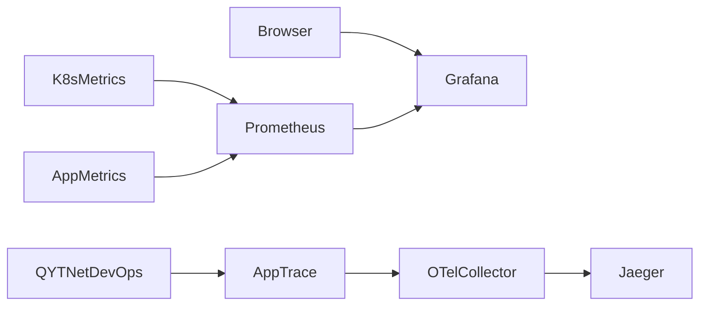

# 第七章总览：可观测性、K8s 指标与分布式 Trace

## 本章目标

第七章的目标，是把前 6 章已经具备：

- Kubernetes 集群
- Cilium 北向入口
- Longhorn 存储
- GitOps 自动发布
- QYT NetDevOps 微服务

推进到 **具备完整可观测能力** 的状态。

本章结束后，应达到下面状态：

- Kubernetes 自身关键指标已被持续采集
- 节点、Pod、Deployment、命名空间与集群资源状态可视化
- 业务微服务标准 Prometheus 指标可被采集
- 微服务真实 Trace 已写入 `Jaeger`
- `Grafana` 已通过正式域名自动发布
- `Jaeger` 已通过正式域名自动发布
- `Grafana` 数据源与 Dashboard 已自动预置
- 课堂上可直接进入 `Jaeger` 看瀑布图

## 课前理论导读

正式操作前，建议先阅读：

- `docs/00_observability_theory.md`

它负责先把下面几件事讲清楚：

- 监控和可观测性的边界
- Kubernetes 指标到底看什么
- `Prometheus / Grafana / Jaeger / OpenTelemetry` 分别做什么
- 为什么业务 Trace 和 K8s 指标要分层理解

## 本章范围

第七章只聚焦：

- `Prometheus`
- `Grafana`
- `Jaeger`
- `OpenTelemetry Collector`
- Kubernetes 基础指标
- 业务应用指标
- 微服务 Trace

暂不展开：

- 完整告警平台
- 多集群可观测
- 更复杂的网格观测增强

## 本章总关系图

这张图建议配合下面 4 句话：

- `Prometheus` 负责采集和存储指标
- `Grafana` 负责统一展示指标
- `Jaeger` 负责展示分布式调用链和瀑布图
- `OpenTelemetry` 负责让微服务把 Trace 发出来

## 本章脚本执行矩阵

| 步骤 | 文档 | 脚本 | 执行标记 | 说明 |
| :--- | :--- | :--- | :--- | :--- |
| 0 | `00_observability_theory.md` | 无 | 建议先读 | 先理清 Metrics、Trace 与 K8s 观测主线 |
| 1 | `02_install_prometheus_grafana_jaeger.md` | `scripts/02_install_observability_stack.sh` | 必须执行 | 升级业务应用到第七章版本，并安装 Prometheus、Grafana、Jaeger、OTel Collector |
| 2 | `03_publish_grafana_and_verify.md` | `scripts/03_verify_observability.sh` | 只读验收 | 验证 Grafana、Jaeger、Targets 与大盘 |
| 3 | `04_trace_demo_and_fault_location.md` | 无 | 课堂演示 | 从 Grafana 指标跳到 Jaeger 瀑布图定位问题 |

## 本章执行顺序

请严格按下面顺序执行：

0. `00_observability_theory.md`
1. `02_install_prometheus_grafana_jaeger.md`
2. `03_publish_grafana_and_verify.md`
3. `04_trace_demo_and_fault_location.md`

## 第七章起点状态

第七章开始前，默认你已经完成第六章，并满足下面条件：

- 所有节点均为 `Ready`
- 第六章最终验收已通过
- `ops` 已具备 `kubectl`、`helm`
- `ops` 已提供 `http://ops:9000/`
- `Harbor`、`Gitea`、`Argo CD` 仍然保留
- `https://netdevops.qytk8s.com` 可访问

## 正式入口设计

第七章继续沿用前面章节已经建立好的 `app-gateway`，但只新增本章自己的入口对象：

- `grafana.qytk8s.com`
- `jaeger.qytk8s.com`

这一章采用和前两章一致的做法：

- 用 `20_gateway_observability_listeners.json` 增量补 `listener`
- 用 `21_gateway_observability_https.yaml` 单独管理 `HTTPRoute` 与 `ReferenceGrant`

也就是说，第七章只增加自己的观测入口，不替换前面章节已经存在的入口对象。

## 版本冻结

- Kubernetes：`v1.33.9`
- `kube-prometheus-stack`：本章脚本内固定
- `Jaeger`：本章脚本内固定
- `OpenTelemetry Collector`：本章脚本内固定
- Grafana 域名：`grafana.qytk8s.com`
- Jaeger 域名：`jaeger.qytk8s.com`

## 关键设计冻结

- 正式业务入口仍沿用 `Cilium Gateway API`
- 第七章不切业务入口到 `Istio`
- `Grafana` 专注展示指标
- `Jaeger` 专注展示 Trace 瀑布图
- `Grafana` 与 `Jaeger` 都必须自动发布，不允许课堂手工点配置
- `wk-obs01` 优先承载本章可观测组件

## 下一步

先进入理论导读，理清本章技术边界：

- `docs/00_observability_theory.md`
