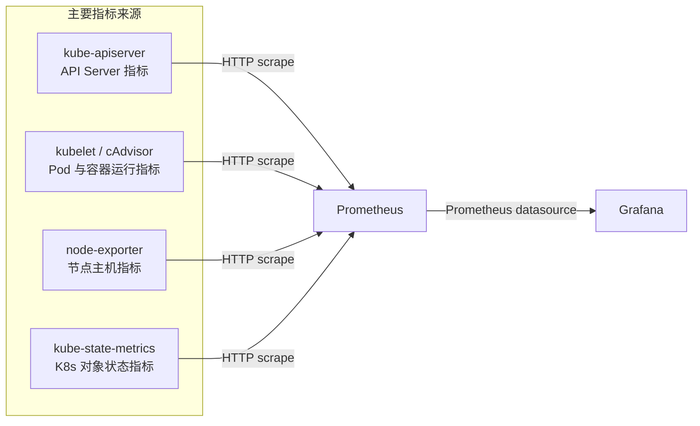
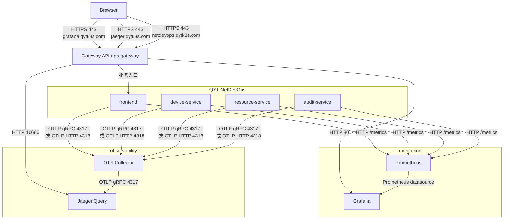

# 第 2 步：安装 Prometheus、Grafana、Jaeger 与 OTel Collector

## 本步目标

把第七章需要的观测栈一次性装进集群，并把 `Grafana` 与 `Jaeger` 正式挂到现有 `Gateway` 入口上。

本步完成后，应达到下面状态：

- 业务代码已同步到 Git 仓库
- 业务镜像已更新到带可观测能力的新版本
- 业务 Deployment 已完成滚动
- Kubernetes 基础指标已被采集
- 业务服务指标已被采集
- `Grafana` 已就绪
- `Jaeger` 已就绪
- `OpenTelemetry Collector` 已就绪

## 理论说明

这一页要同时完成 3 层动作：

1. 升级业务应用  
当前集群里跑的还是前一章交付的业务版本。本步会先把带指标和 Trace 的第七章版本发布上去。

2. 安装可观测组件  
本步会安装：

- `kube-prometheus-stack`
- `Jaeger`
- `OpenTelemetry Collector`

3. 发布正式可视化入口  
本步不会新建一个独立 Gateway，而是把第七章自己的入口对象增量补到现有 `app-gateway` 上：

- `grafana.qytk8s.com`
- `jaeger.qytk8s.com`

---

## 执行命令与脚本操作

<div style="padding: 12px 14px; border: 1px solid #666; border-left: 6px solid #34a853; border-radius: 6px; background: rgba(52,168,83,0.08); margin: 12px 0;">
<strong>本步执行方式</strong><br/>
这一页只需要执行一条主脚本 <a href="/docker_k8s_2026/k8s/07-observability-and-tracing/scripts/02_install_observability_stack.sh"><code>02_install_observability_stack.sh</code></a>；它会串起业务升级、观测栈安装和正式入口发布。
</div>

<div style="padding: 12px 14px; border: 1px solid #666; border-left: 6px solid #ea4335; border-radius: 6px; background: rgba(234,67,53,0.10); margin: 8px 0;">
<strong>❗ 本条命令必须粘贴执行</strong><br/>
执行这条脚本，会一次性完成第七章观测栈安装、业务升级和观测入口发布。
</div>

```bash
bash /docker_k8s_2026/k8s/07-observability-and-tracing/scripts/02_install_observability_stack.sh
```

这个脚本会按下面顺序完成整条安装链路：

1. 安装 `Helm` 并准备 Chart 仓库
2. 发布带可观测能力的新业务版本
3. 准备命名空间和正式域名证书
4. 安装 `kube-prometheus-stack`
5. 安装 `Jaeger`
6. 安装 `OpenTelemetry Collector`
7. 创建业务 `ServiceMonitor`
8. 给现有 `app-gateway` 增量补 `listener`
9. 应用第七章自己的 `HTTPRoute / ReferenceGrant`
10. 下发 `Grafana` Dashboard
11. 等待 `Grafana` 和 `Jaeger` 正式入口就绪

如果只用一句最短的话概括，这个脚本其实同时做了 3 件事：

- 升级业务应用
- 安装观测栈
- 发布 `Grafana` 与 `Jaeger` 正式入口

---

## 图 1：Kubernetes 指标链路



这张图先看清 4 类来源：

- `kube-apiserver`
  - 主要看 API 请求量、错误和延迟
- `kubelet / cAdvisor`
  - 主要看 Pod / 容器 CPU、内存、文件系统等运行指标
- `node-exporter`
  - 主要看节点 CPU、内存、磁盘、网络等主机指标
- `kube-state-metrics`
  - 主要看 Pod、Deployment、Node、PVC 等 Kubernetes 对象状态

一句话总结：

- 第七章里，`Prometheus` 会持续抓取 Kubernetes 平台指标，再由 `Grafana` 统一展示。

## 图 2：业务指标与 Trace 采集链路



这张图先看清 5 件事：

- `frontend`、`device-service`、`resource-service`、`audit-service`
  - 都会暴露自己的 `/metrics`
- `Prometheus`
  - 会主动去抓这些服务的 `/metrics`
- 这些业务指标
  - 重点用于看请求量、错误率、延迟和服务间调用耗时
- 业务服务
  - 会把 `Trace` 按 `OTLP` 发给 `OTel Collector`
- `OTel Collector`
  - 统一接收并转发 `Trace`，最后由 `Jaeger` 展示完整调用链和瀑布图

---

## App 级别到底改了什么

这一章不是在安装脚本里临时 patch 应用代码。

更准确地说：

- 当前工作区里的 `apps/qytang-netdevops`
- 本身就已经是“带指标与 Trace”的版本
- 本步做的事情，是把这份已经改好的应用版本正式发布到集群

<div style="padding: 12px 14px; border: 1px solid #666; border-left: 6px solid #8ab4f8; border-radius: 6px; background: rgba(138,180,248,0.08); margin: 10px 0;">
<strong>说明卡片</strong><br/>
这一段属于回顾说明，目的是让学员看清第七章业务版本相比前一章到底多了哪些可观测能力。这里默认只读理解，不要求在本页手工修改应用代码。
</div>

最值得课堂上看清的改动，主要是下面 4 类。

### 改动 1：统一补了指标采集代码

<div style="padding: 12px 14px; border: 1px solid #666; border-left: 6px solid #8ab4f8; border-radius: 6px; background: rgba(138,180,248,0.08); margin: 10px 0;">
<strong>代码卡片</strong><br/>
文件：<a href="/docker_k8s_2026/apps/qytang-netdevops/backend/common/metrics.py"><code>apps/qytang-netdevops/backend/common/metrics.py</code></a><br/>
类型：<code>Python 公共模块</code><br/>
作用：定义第七章统一复用的 HTTP 请求总量与请求耗时指标。
</div>

```python
HTTP_REQUESTS_TOTAL = Counter(
    "qytang_http_requests_total",
    "QYT NetDevOps HTTP request total.",
    ["service", "method", "path", "status_code"],
)

HTTP_REQUEST_DURATION_SECONDS = Histogram(
    "qytang_http_request_duration_seconds",
    "QYT NetDevOps HTTP request duration.",
    ["service", "method", "path"],
)
```

关键解释：

- 这里定义了统一的请求总量指标
- 也定义了统一的请求耗时指标
- 后面各个服务都会复用这套公共逻辑

### 改动 2：服务里真正暴露了 /metrics

<div style="padding: 12px 14px; border: 1px solid #666; border-left: 6px solid #8ab4f8; border-radius: 6px; background: rgba(138,180,248,0.08); margin: 10px 0;">
<strong>代码卡片</strong><br/>
文件：<a href="/docker_k8s_2026/apps/qytang-netdevops/backend/device_service/main.py"><code>apps/qytang-netdevops/backend/device_service/main.py</code></a><br/>
类型：<code>Python 服务入口代码</code><br/>
作用：在服务里记录 HTTP 指标，并真正暴露 <code>/metrics</code> 给 <code>Prometheus</code> 抓取。
</div>

```python
metrics = MetricsCollector(SERVICE_NAME)

@app.middleware("http")
async def metrics_middleware(request: Request, call_next):
    started = perf_counter()
    response = await call_next(request)
    metrics.record_http(request.method, request.url.path, response.status_code, perf_counter() - started)
    return response

@app.get("/metrics", response_class=PlainTextResponse)
def metrics_endpoint() -> str:
    return metrics.render()
```

关键解释：

- `metrics_middleware`
  - 说明这个服务会在每次请求进来时记录 HTTP 指标
- `@app.get("/metrics")`
  - 说明这个服务已经真正暴露了 `Prometheus` 可以抓取的指标接口

所以第七章里业务指标不是临时拼出来的，而是服务代码自己产出的。

### 改动 3：服务里真正接了 OpenTelemetry

<div style="padding: 12px 14px; border: 1px solid #666; border-left: 6px solid #8ab4f8; border-radius: 6px; background: rgba(138,180,248,0.08); margin: 10px 0;">
<strong>代码卡片</strong><br/>
文件：<a href="/docker_k8s_2026/apps/qytang-netdevops/backend/common/tracing.py"><code>apps/qytang-netdevops/backend/common/tracing.py</code></a><br/>
类型：<code>Python 公共模块</code><br/>
作用：把服务接到 <code>OpenTelemetry</code>，让入站请求自动产生并导出 <code>Trace</code>。
</div>

```python
provider.add_span_processor(
    BatchSpanProcessor(
        OTLPSpanExporter(
            endpoint=get_trace_endpoint(),
            insecure=True,
        )
    )
)

if app is not None:
    FastAPIInstrumentor.instrument_app(app, tracer_provider=provider)
```

关键解释：

- `OTLPSpanExporter`
  - 说明服务会把 Trace 按 `OTLP` 发出去
- `FastAPIInstrumentor.instrument_app`
  - 说明入站请求会自动产生 Trace

### 改动 4：部署模板里补了 Trace 上报地址

<div style="padding: 12px 14px; border: 1px solid #666; border-left: 6px solid #fbbc04; border-radius: 6px; background: rgba(251,188,4,0.10); margin: 10px 0;">
<strong>YAML 卡片</strong><br/>
YAML 文件：<a href="/docker_k8s_2026/apps/qytang-netdevops/deploy/helm/qytang-netdevops/templates/deployments.yaml"><code>apps/qytang-netdevops/deploy/helm/qytang-netdevops/templates/deployments.yaml</code></a><br/>
对象：<code>Helm template</code><br/>
作用：把 <code>OTel Collector</code> 的上报地址注入到业务服务环境变量。
</div>

```yaml
- name: QYTANG_OTEL_ENDPOINT
  value: {{ .Values.observability.otel.endpoint | quote }}
```

<div style="padding: 12px 14px; border: 1px solid #666; border-left: 6px solid #fbbc04; border-radius: 6px; background: rgba(251,188,4,0.10); margin: 10px 0;">
<strong>YAML 卡片</strong><br/>
YAML 文件：<a href="/docker_k8s_2026/apps/qytang-netdevops/deploy/helm/qytang-netdevops/values-lab.yaml"><code>apps/qytang-netdevops/deploy/helm/qytang-netdevops/values-lab.yaml</code></a><br/>
对象：<code>Helm values</code><br/>
作用：定义第七章实验环境下 <code>OTel Collector</code> 的实际地址。
</div>

```yaml
observability:
  environment: lab
  otel:
    endpoint: http://otel-opentelemetry-collector.observability:4317
```

关键解释：

- 应用不是凭空知道 Trace 该发到哪里
- 第七章是在部署模板里把 `OTel Collector` 地址注入进服务环境变量

如果只用一句最短的话概括 App 级改动，就是：

- 代码里补了指标
- 代码里补了 Trace
- 部署里补了 `OTel Collector` 上报地址

---

## 观测栈安装与入口发布的关键 YAML

### `01_kube_prometheus_stack_values.yaml`

<div style="padding: 12px 14px; border: 1px solid #666; border-left: 6px solid #fbbc04; border-radius: 6px; background: rgba(251,188,4,0.10); margin: 10px 0;">
<strong>YAML 卡片</strong><br/>
YAML 文件：<code>k8s/07-observability-and-tracing/manifests/01_kube_prometheus_stack_values.yaml</code><br/>
对象：<code>Helm values</code><br/>
作用：定义 <code>kube-prometheus-stack</code> 的持久化、节点放置和 Grafana 默认行为。
</div>

```yaml
grafana:
  persistence:
    enabled: true
    storageClassName: longhorn
  nodeSelector:
    node-role: observability

prometheus:
  prometheusSpec:
    storageSpec:
      volumeClaimTemplate:
        spec:
          storageClassName: longhorn
    nodeSelector:
      node-role: observability
```

关键解释：

- `grafana.persistence.enabled: true`
  - `Grafana` 数据不是临时写在容器里，而是要持久保存
- `grafana.persistence.storageClassName: longhorn`
  - `Grafana` 的持久化数据落到 `Longhorn`
- `prometheus.prometheusSpec.storageSpec`
  - `Prometheus` 也会为自己的时序数据申请持久卷
- `nodeSelector: node-role: observability`
  - 这一章的核心观测组件优先调度到观测节点

这一份 values 最重要的结论就是：

- `Grafana` 和 `Prometheus` 都会把数据落到 `Longhorn`
- 这一章的观测组件优先放到 `wk-obs01`

### `02_jaeger_values.yaml`

<div style="padding: 12px 14px; border: 1px solid #666; border-left: 6px solid #fbbc04; border-radius: 6px; background: rgba(251,188,4,0.10); margin: 10px 0;">
<strong>YAML 卡片</strong><br/>
YAML 文件：<code>k8s/07-observability-and-tracing/manifests/02_jaeger_values.yaml</code><br/>
对象：<code>Helm values</code><br/>
作用：定义 <code>Jaeger</code> 的接收协议、查询界面和观测节点部署方式。
</div>

```yaml
jaeger:
  nodeSelector:
    node-role: observability

config:
  extensions:
    jaeger_query:
      storage:
        traces: primary_store
  receivers:
    otlp:
      protocols:
        grpc:
          endpoint: 0.0.0.0:4317
        http:
          endpoint: 0.0.0.0:4318
```

关键解释：

- `jaeger.nodeSelector`
  - `Jaeger` 也优先调度到观测节点
- `receivers.otlp`
  - 第七章业务服务会按 `OTLP` 协议把 Trace 发进来
- `extensions.jaeger_query`
  - 这一部分对应后面通过域名访问的查询界面

这一份 values 最重要的结论就是：

- `Jaeger` 负责展示 Trace
- `OTLP` 是第七章微服务上报 Trace 的正式入口

### `03_otel_collector_values.yaml`

<div style="padding: 12px 14px; border: 1px solid #666; border-left: 6px solid #fbbc04; border-radius: 6px; background: rgba(251,188,4,0.10); margin: 10px 0;">
<strong>YAML 卡片</strong><br/>
YAML 文件：<code>k8s/07-observability-and-tracing/manifests/03_otel_collector_values.yaml</code><br/>
对象：<code>Helm values</code><br/>
作用：定义 <code>OTel Collector</code> 如何接收业务 Trace，再转发给 <code>Jaeger</code>。
</div>

```yaml
mode: deployment

config:
  receivers:
    otlp:
      protocols:
        grpc:
          endpoint: 0.0.0.0:4317
        http:
          endpoint: 0.0.0.0:4318
  exporters:
    otlp_grpc/jaeger:
      endpoint: jaeger.observability:4317
      tls:
        insecure: true

nodeSelector:
  node-role: observability
```

关键解释：

- `receivers.otlp`
  - `OTel Collector` 负责接收业务服务发来的 Trace
- `exporters.otlp_grpc/jaeger`
  - 收到的 Trace 最后会转发给 `Jaeger`
- `nodeSelector`
  - `OTel Collector` 也优先放到观测节点

这一份 values 最重要的结论就是：

- `OTel Collector` 是 Trace 中转站
- 业务服务先发给它
- 它再转给 `Jaeger`

### `10_qytang_netdevops_servicemonitor.yaml`

<div style="padding: 12px 14px; border: 1px solid #666; border-left: 6px solid #fbbc04; border-radius: 6px; background: rgba(251,188,4,0.10); margin: 10px 0;">
<strong>YAML 卡片</strong><br/>
YAML 文件：<code>k8s/07-observability-and-tracing/manifests/10_qytang_netdevops_servicemonitor.yaml</code><br/>
对象：<code>ServiceMonitor</code><br/>
作用：告诉 <code>Prometheus</code> 去哪里抓第七章业务应用的 <code>/metrics</code>。
</div>

```yaml
spec:
  namespaceSelector:
    matchNames:
      - qytang-netdevops
  selector:
    matchLabels:
      app.kubernetes.io/part-of: qytang-netdevops
  endpoints:
    - port: http
      path: /metrics
      interval: 15s
```

关键解释：

- `namespaceSelector.matchNames`
  - 只抓 `qytang-netdevops` 命名空间里的目标
- `selector.matchLabels`
  - 只抓带这组标签的业务服务
- `endpoints.path: /metrics`
  - `Prometheus` 真正抓的是业务服务暴露出来的 `/metrics`

这一份清单最重要的结论就是：

- 第七章不是只装了 `Prometheus`
- 还明确告诉了它去哪里抓业务指标

### `20_gateway_observability_listeners.json`

<div style="padding: 12px 14px; border: 1px solid #666; border-left: 6px solid #fbbc04; border-radius: 6px; background: rgba(251,188,4,0.10); margin: 10px 0;">
<strong>YAML 卡片</strong><br/>
YAML 文件：<code>k8s/07-observability-and-tracing/manifests/20_gateway_observability_listeners.json</code><br/>
对象：<code>Gateway listeners</code><br/>
作用：给现有 <code>app-gateway</code> 增量补上 <code>Grafana</code> 和 <code>Jaeger</code> 的监听入口。
</div>

```json
[
  {
    "name": "grafana-http",
    "hostname": "grafana.qytk8s.com",
    "port": 80,
    "protocol": "HTTP"
  },
  {
    "name": "grafana-https",
    "hostname": "grafana.qytk8s.com",
    "port": 443,
    "protocol": "HTTPS",
    "tls": {
      "mode": "Terminate",
      "certificateRefs": [
        {
          "kind": "Secret",
          "name": "grafana-qytk8s-com-tls"
        }
      ]
    }
  },
  {
    "name": "jaeger-http",
    "hostname": "jaeger.qytk8s.com",
    "port": 80,
    "protocol": "HTTP"
  },
  {
    "name": "jaeger-https",
    "hostname": "jaeger.qytk8s.com",
    "port": 443,
    "protocol": "HTTPS",
    "tls": {
      "mode": "Terminate",
      "certificateRefs": [
        {
          "kind": "Secret",
          "name": "jaeger-qytk8s-com-tls"
        }
      ]
    }
  }
]
```

关键解释：

- `grafana-http / grafana-https`
  - 为 `Grafana` 新增一对独立 `listener`
- `jaeger-http / jaeger-https`
  - 为 `Jaeger` 新增一对独立 `listener`
- `certificateRefs`
  - 指向本章脚本生成的正式证书 `Secret`

这一份文件最重要的结论就是：

- 第七章只给现有 `app-gateway` 增量补 4 个监听器
- 不会覆盖前面章节已经存在的 `longhorn` 和 `netdevops` listener

### `21_gateway_observability_https.yaml`

<div style="padding: 12px 14px; border: 1px solid #666; border-left: 6px solid #fbbc04; border-radius: 6px; background: rgba(251,188,4,0.10); margin: 10px 0;">
<strong>YAML 卡片</strong><br/>
YAML 文件：<code>k8s/07-observability-and-tracing/manifests/21_gateway_observability_https.yaml</code><br/>
对象：<code>HTTPRoute + ReferenceGrant</code><br/>
作用：把 <code>grafana.qytk8s.com</code> 和 <code>jaeger.qytk8s.com</code> 正式接到统一网关入口。
</div>

```yaml
kind: HTTPRoute
metadata:
  name: grafana-http-redirect
spec:
  parentRefs:
    - name: app-gateway
      sectionName: grafana-http
  rules:
    - filters:
        - type: RequestRedirect
          requestRedirect:
            scheme: https
            statusCode: 301
---
kind: HTTPRoute
metadata:
  name: grafana-https-backend
spec:
  parentRefs:
    - name: app-gateway
      sectionName: grafana-https
  rules:
    - backendRefs:
        - name: kps-grafana
          namespace: monitoring
          port: 80
---
kind: HTTPRoute
metadata:
  name: jaeger-https-backend
spec:
  parentRefs:
    - name: app-gateway
      sectionName: jaeger-https
  rules:
    - backendRefs:
        - name: jaeger-query
          namespace: observability
          port: 16686
---
kind: ReferenceGrant
metadata:
  name: allow-gateway-to-jaeger
  namespace: observability
spec:
  from:
    - group: gateway.networking.k8s.io
      kind: HTTPRoute
      namespace: gateway-demo
  to:
    - group: ""
      kind: Service
```

关键解释：

- `grafana-http-redirect / jaeger-http-redirect`
  - `HTTP` 统一只做 `301` 跳转
- `grafana-https-backend / jaeger-https-backend`
  - 真正把流量转发到后端 `Service`
- `ReferenceGrant`
  - 因为 `HTTPRoute` 在 `gateway-demo`
  - 后端 `Service` 在 `monitoring` 和 `observability`
  - 所以必须显式允许跨命名空间引用

这一份清单最重要的结论就是：

- `HTTPS` 才真正转发到 `Grafana` 和 `Jaeger`
- 第七章自己的入口对象全部由本章自己管理

---

## 验证方法

<div style="padding: 10px 14px; border: 1px solid #666; border-left: 4px solid #8ab4f8; border-radius: 6px; background: rgba(138,180,248,0.08); margin: 8px 0;">
<strong>ℹ️ 可选执行</strong><br/>
下面这些命令都是安装完成后的只读检查，用来确认组件、网关入口和正式域名是否已经就绪。
</div>

```bash
kubectl -n monitoring get pods,svc
```

关键看点：

- 重点看 `kps-grafana`、`prometheus` 相关 Pod 是否已经 `Running`
- 重点看 `kps-grafana` Service 是否存在

预期结果：

- `monitoring` 命名空间中应出现 `Grafana` 和 `Prometheus` 相关资源

```bash
kubectl -n observability get pods,svc
```

关键看点：

- 重点看 `jaeger`、`jaeger-query`、`otel-collector` 是否已经就绪
- 重点看 `jaeger-query` Service 是否存在

预期结果：

- `observability` 命名空间中应出现 `Jaeger` 和 `OTel Collector`

```bash
kubectl get gateway,httproute -n gateway-demo
```

关键看点：

- 重点不是对象数量
- 而是要确认已经出现：
  - `grafana-http-redirect`
  - `grafana-https-backend`
  - `jaeger-http-redirect`
  - `jaeger-https-backend`

预期结果：

- `app-gateway` 仍然存在
- 第七章自己的 `HTTPRoute` 已经创建成功

## 下一步

进入第 3 步，统一做正式入口、Targets、Dashboard 和 Trace 验收：

- `docs/03_publish_grafana_and_verify.md`
