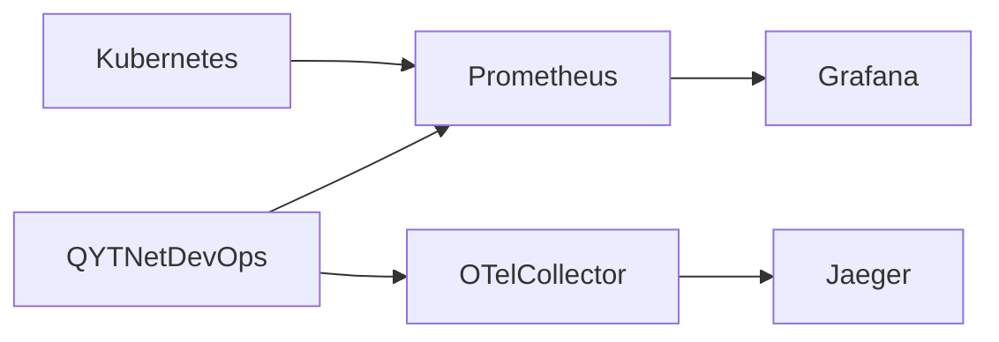

# 第 1 步：可观测性理论导读

## 本步目标

在正式安装监控栈之前，先把第七章最容易混淆的几个点讲清楚：

- 为什么 Kubernetes 指标和业务 Trace 不能混为一谈
- `Prometheus`、`Grafana`、`Jaeger`、`OpenTelemetry` 各自负责什么
- 为什么本章先不展开日志

## 这一章到底在解决什么问题

到第六章结束时，你已经能回答：

- 应用能不能发布成功
- 域名能不能访问
- Pod 有没有跑起来

但你还不能稳定回答：

- 哪个节点资源紧张
- 哪个命名空间工作负载异常
- 哪个接口慢
- 慢在哪个服务
- 慢在服务间调用还是数据库访问

这正是第七章要解决的问题。

## Metrics 和 Trace 的边界

### Metrics 适合回答什么

- 当前 CPU、内存、磁盘、网络趋势如何
- 某个服务 QPS 是否升高
- 某个接口错误率是否升高
- P95、P99 延迟是否变差

### Trace 适合回答什么

- 某一次请求具体经过了哪些服务
- 哪一段调用最慢
- 哪个 span 报错
- 上游慢还是下游慢

## 本章组件关系

## 每个组件做什么

### `Prometheus`

负责采集：

- Kubernetes 自身指标
- 节点指标
- Pod / Deployment / 命名空间指标
- 业务服务 `/metrics`

### `Grafana`

负责统一展示：

- Kubernetes 基础监控
- 业务应用监控

### `Jaeger`

负责展示：

- 业务请求的 Trace
- span 之间的上下游关系
- Trace 瀑布图

### `OpenTelemetry`

负责让业务代码产生 Trace 并发送出去。

这里要特别注意：

- Kubernetes 指标不依赖 `OpenTelemetry`
- 微服务 Trace 依赖 `OpenTelemetry`

## 为什么本章保留 Cilium 正式入口

本章重点是：

- K8s 指标
- 业务指标
- 微服务 Trace

不是重新改造业务入口。

因此当前继续保持：

- `netdevops.qytk8s.com` 仍走 `Cilium Gateway API`
- 第七章只在现有稳定入口之上补观测能力

## 为什么先不做日志

日志当然也属于可观测性的一部分，但这一章如果同时展开：

- Metrics
- Trace
- Logs

课堂主线会过长。

因此本章先完成：

- 看得见 Kubernetes
- 看得见应用指标
- 看得见一次请求的完整链路

## 本步完成标准

当你已经明确下面结论，就可以进入下一步：

- K8s 指标和业务 Trace 是两条不同数据流
- `Prometheus` 不负责存 Trace
- `Jaeger` 不负责存指标
- `Grafana` 是指标展示层
- `OpenTelemetry` 主要解决微服务 Trace

## 下一步

进入第 2 步，准备第七章的资产与版本冻结：

- `docs/03_prepare_observability_assets.md`
