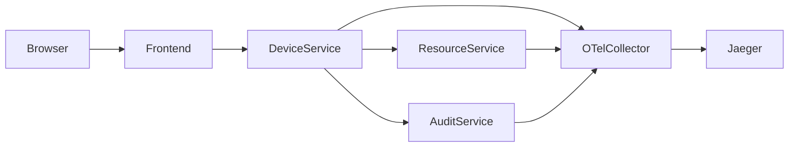

# 第 3 步：给 QYT NetDevOps 接入指标与 Trace

## 本步目标

让当前 GitOps 发布的业务应用具备下面能力：

- 暴露标准 Prometheus 指标
- 记录服务间调用耗时
- 为关键业务请求生成真实 Trace
- 把 Trace 发送到 `OpenTelemetry Collector`

## 为什么这一节以“只读理解”为主

这一节的本质是：

- 业务代码已经按第七章要求接好
- 课堂上重点是理解它做了什么
- 真正发布到集群仍沿用 GitOps 与镜像更新主线，并在下一步安装脚本中统一完成

也就是说：

- 学员不用现场手工改一堆 SDK 代码
- 但必须理解这些指标和 Trace 是从哪里来的

这里还要额外记住一件事：

- 现在看到的是“第七章目标代码形态”
- 此时集群里运行的应用仍可能还是前一章版本
- 下一步安装脚本会先同步代码、构建新镜像、触发业务滚动，再安装观测栈

## 这一节的改动点

### 业务指标

为后端服务统一补齐：

- 请求总量
- 请求耗时直方图
- 按路径和状态码维度统计
- 服务间 HTTP 调用计数与耗时

### 微服务 Trace

为后端服务统一补齐：

- FastAPI 入站请求 span
- 服务间调用 span
- 数据库访问 span
- 关键业务逻辑 span

## Trace 数据流

## 本节完成标准

当下面结论成立时，就可以进入下一步：

- 业务指标不是临时脚本拼出来的，而是服务代码直接暴露
- 微服务 Trace 不依赖手工抓包，而是由 `OpenTelemetry` 自动产生
- 第七章最终安装后，`Grafana` 能看到指标，`Jaeger` 能看到 Trace 瀑布图
- 你已经理解：真正让这些代码在集群里生效，是下一步安装脚本负责的

## 下一步

进入第 4 步，安装 `Prometheus`、`Grafana`、`Jaeger` 和 `OpenTelemetry Collector`：

- `docs/04_install_prometheus_grafana_jaeger.md`
