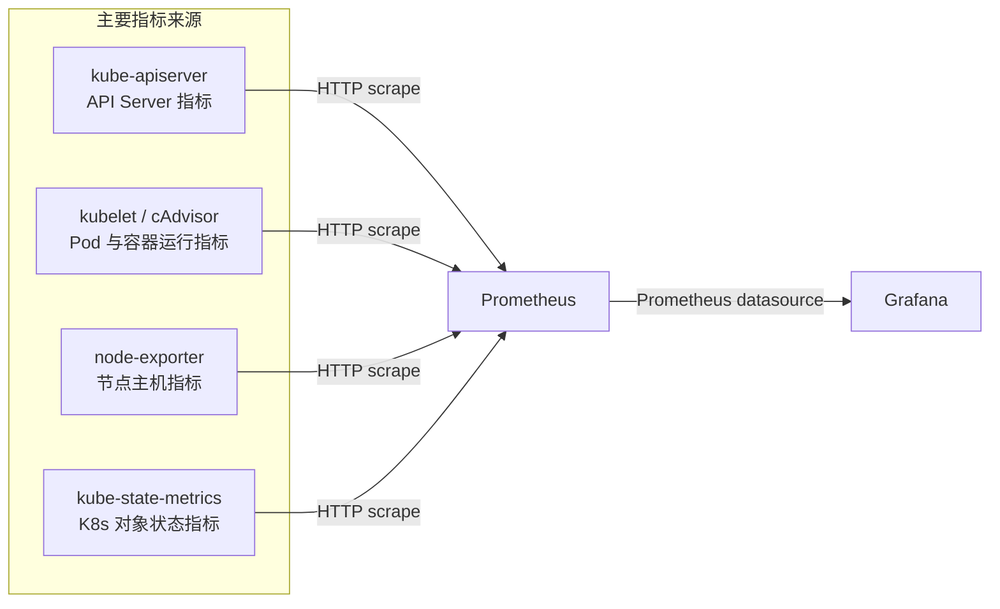
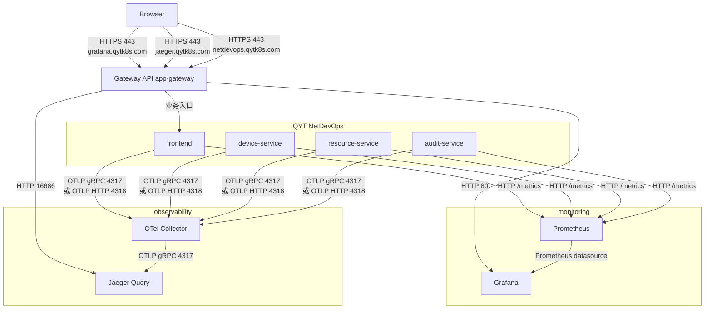
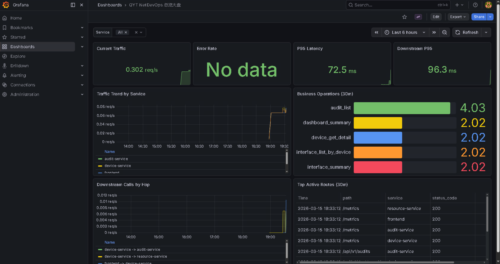
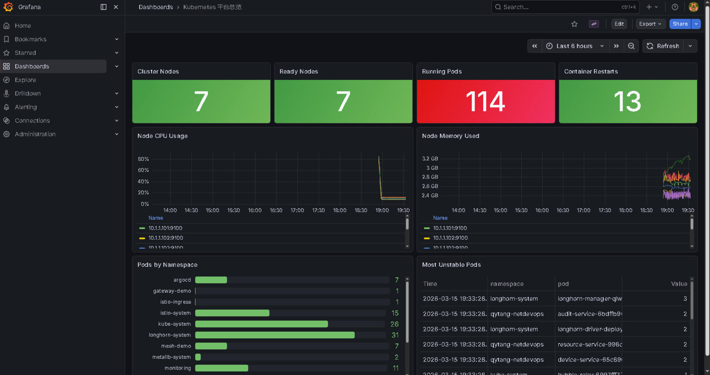
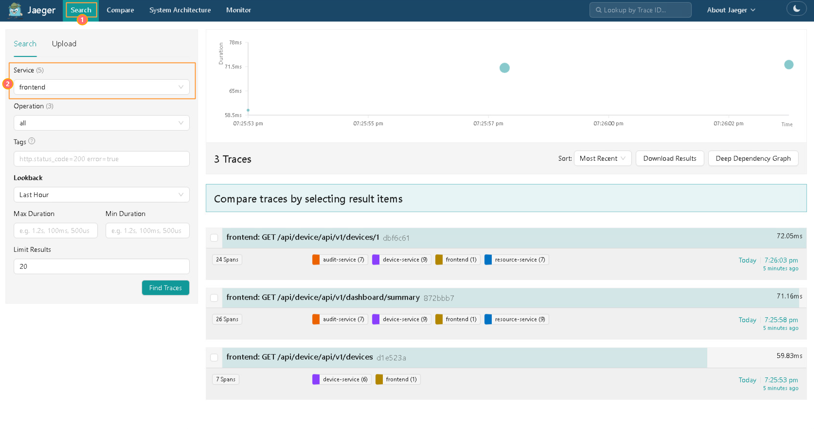
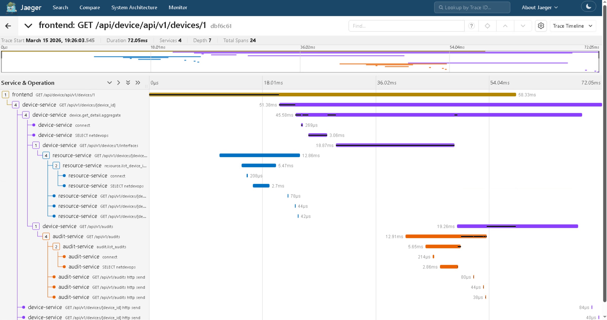
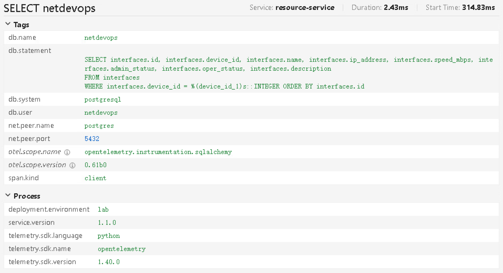
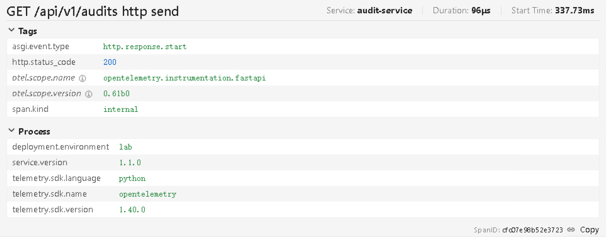

# 第 3 步：Trace 演示与分析

## 本步目标

用一条真实业务请求，把第七章的主线讲完整：

- 先从 K8s / 应用指标发现异常
- 再进入 Trace 找到慢点
- 最后定位到具体服务或下游调用

## 理论说明

这一页不再安装组件，只把前面已经具备的指标、Trace 和正式入口串成一条完整分析链：

- 先看指标
- 再看 Trace
- 最后定位慢点

---

## 图 1：Kubernetes 指标链路



## 图 2：业务指标与 Trace 采集链路



---

## 演示前的执行边界

<div style="padding: 12px 14px; border: 1px solid #666; border-left: 6px solid #ea4335; border-radius: 6px; background: rgba(234,67,53,0.10); margin: 12px 0;">
<strong>测试边界</strong><br/>
这一页先执行下面 3 条业务请求，用来触发一轮真实流量。它们不会修改系统状态，但会直接影响后面在 <code>Grafana</code> 和 <code>Jaeger</code> 里看到的指标与 Trace。
</div>

### 请求 1：先取一个真实设备 ID

<div style="padding: 12px 14px; border: 1px solid #666; border-left: 6px solid #ea4335; border-radius: 6px; background: rgba(234,67,53,0.10); margin: 8px 0;">
<strong>❗ 本条命令必须粘贴执行</strong><br/>
先取一个真实设备 ID，给后面的设备详情请求准备参数。
</div>

```bash
DEVICE_ID=$(curl --resolve netdevops.qytk8s.com:443:10.1.1.60 \
  --cacert /docker_k8s_2026/k8s/01-k8s-architecture/pki/harbor/harbor-ca.crt \
  -s https://netdevops.qytk8s.com/api/device/api/v1/devices | python3 -c 'import json,sys; print(json.load(sys.stdin)[0]["id"])')
```

作用：取一个真实设备 ID，给后面的设备详情请求准备参数。

### 请求 2：触发 Dashboard 汇总链路

<div style="padding: 12px 14px; border: 1px solid #666; border-left: 6px solid #ea4335; border-radius: 6px; background: rgba(234,67,53,0.10); margin: 8px 0;">
<strong>❗ 本条命令必须粘贴执行</strong><br/>
触发 Dashboard 汇总链路，后面更适合在 <code>Grafana</code> 里看请求量和延迟变化。
</div>

```bash
curl --resolve netdevops.qytk8s.com:443:10.1.1.60 \
  --cacert /docker_k8s_2026/k8s/01-k8s-architecture/pki/harbor/harbor-ca.crt \
  -s https://netdevops.qytk8s.com/api/device/api/v1/dashboard/summary >/dev/null
```

作用：触发 Dashboard 汇总链路，更适合在 `Grafana` 里看请求量和延迟变化。

### 请求 3：触发设备详情链路

<div style="padding: 12px 14px; border: 1px solid #666; border-left: 6px solid #ea4335; border-radius: 6px; background: rgba(234,67,53,0.10); margin: 8px 0;">
<strong>❗ 本条命令必须粘贴执行</strong><br/>
触发单设备详情链路，后面更适合在 <code>Jaeger</code> 里看完整 Trace 和瀑布图。
</div>

```bash
curl --resolve netdevops.qytk8s.com:443:10.1.1.60 \
  --cacert /docker_k8s_2026/k8s/01-k8s-architecture/pki/harbor/harbor-ca.crt \
  -s "https://netdevops.qytk8s.com/api/device/api/v1/devices/${DEVICE_ID}" >/dev/null
```

作用：触发单设备详情链路，更适合在 `Jaeger` 里看完整 Trace。

关键看点：

- 第 1 条请求准备真实参数
- 第 2 条请求更适合看指标
- 第 3 条请求更适合看 Trace

---

## 课堂演示顺序

<div style="padding: 10px 14px; border: 1px solid #666; border-left: 4px solid #8ab4f8; border-radius: 6px; background: rgba(138,180,248,0.08); margin: 8px 0;">
<strong>ℹ️ 可选观察</strong><br/>
下面这一段主要是课堂上的 GUI 观察路径。重点是按顺序看大盘、看查询结果、看瀑布图，不涉及额外脚本。
</div>

### Grafana

- 访问 `https://grafana.qytk8s.com`
- 先打开 `QYT NetDevOps` 总览大盘
- 再打开 Kubernetes 平台大盘
- 重点看请求量、接口延迟、错误率和节点 / Pod 状态

先看业务总览大盘：



再看 Kubernetes 平台大盘：



先判断：

- 是业务接口变慢，还是平台资源先异常
- 是单个服务有问题，还是整体状态异常

### 触发业务流量

- 依次执行前面的 3 条请求
- 先让指标变化，再让 `Jaeger` 中出现新的 Trace

### Jaeger

- 访问 `https://jaeger.qytk8s.com`
- 在 `Service` 中优先选择 `frontend` 或 `device-service`
- 再点 `Find Traces`
- 最后进入单条 Trace 看瀑布图

先看查询结果页：



再进入单条 Trace 的瀑布图详情页：



这张图先抓 6 个点：

- 这是一条真实的设备详情请求：
  - `frontend: GET /api/device/api/v1/devices/1`
  - 整条 Trace 共经过 `4` 个服务，包含 `24` 个 spans，总时长约 `72.05ms`
- 最上面的 `frontend 58.33ms`
  - 表示这次请求在 `frontend` 根 span 上持续了约 `58.33ms`
  - 这里更接近“这次后端请求在入口服务上的总耗时”，不是单纯指 `frontend` 自己纯计算了 `58ms`
- 下面的 `device-service 51.38ms`
  - 说明这次请求的大部分时间都花在 `device-service` 这一层
  - `frontend` 自己并不是主要慢点，更多是在等待下游返回
- `device-service device.get_detail.aggregate 45.58ms`
  - 这是 `device-service` 内部的聚合逻辑 span
  - 它把设备主体信息、接口信息和审计信息组合到一起，因此成为这一段调用链里的核心 span
- 在这条聚合链路里，可以继续看到两条主要下游分支：
  - `resource-service` 相关接口链路大约在 `12.86ms` 这一量级
  - `audit-service` 相关接口链路大约在 `19.26ms` 这一量级
  - 从这张图看，`audit-service` 这一支比 `resource-service` 更慢，对总时延影响更明显
- 同时还能看到一些更短的 spans：
  - 例如 `connect`
  - `SELECT netdevops`
  - `http send`
  - 这些一般表示数据库连接、查询或 HTTP 客户端发送等更细的内部动作

再看两个局部细节：

先看一个数据库相关 span：



这张图展示的是 `resource-service` 内部一个数据库查询 span，标题是 `SELECT netdevops`，时长约 `2.43ms`。这里最值得关注的是：

- `db.system: postgresql`
  - 说明这个 span 对应的是一次 `PostgreSQL` 查询
- `db.statement`
  - 直接展示了本次执行的 SQL 语句
  - 这里查的是 `interfaces` 表，并按 `device_id` 过滤
- `net.peer.name: postgres`
  - 说明 `resource-service` 这次访问的是名为 `postgres` 的数据库服务
- `net.peer.port: 5432`
  - 说明访问的是 PostgreSQL 默认端口
- `otel.scope.name: opentelemetry.instrumentation.sqlalchemy`
  - 说明这个 span 来自 SQLAlchemy 自动埋点
- `span.kind: client`
  - 说明 `resource-service` 在这里扮演的是“客户端”，它在向数据库发起请求

这张图说明：

- `Jaeger` 不只看得到“服务调服务”
- 还可以继续下钻到数据库访问层
- 并直接看到 SQL、目标库、端口和这次查询耗时

再看一个框架内部的细粒度 span：



这张图展示的是 `audit-service` 内部一个非常短的 span，标题是 `GET /api/v1/audits http send`，时长约 `96µs`。这里更值得关注的是：

- `asgi.event.type: http.response.start`
  - 说明这个 span 对应的是 ASGI/FastAPI 在开始返回 HTTP 响应时的内部事件
- `http.status_code: 200`
  - 说明这次响应是成功的
- `otel.scope.name: opentelemetry.instrumentation.fastapi`
  - 说明这个 span 来自 FastAPI 自动埋点
- `span.kind: internal`
  - 说明它不是数据库 client span，也不是一次新的对外 RPC
  - 它表示的是服务内部的一个框架级动作

这张图说明：

- 同一条 Trace 里既会有数据库查询这种高价值 span
- 也会有框架内部事件这种更细粒度 span
- 微秒级内部 span 通常不是主要慢点

把两张细节图和前面的瀑布图放在一起看，可以形成一个完整判断：

- 先在瀑布图里判断哪一层最慢、哪条分支最值得继续下钻
- 再进入单个 span 详情页确认：
  - 这是数据库访问
  - 还是 HTTP 下游调用
  - 还是框架内部事件
  - 它具体用了什么协议、访问了哪个目标、返回了什么状态

这里最关键的不是硬背颜色，而是先抓住 3 个阅读原则：

- 左边树形结构看父子关系：
  - 谁调用了谁，谁挂在谁下面
- 右边横条位置看开始时间：
  - 越靠右，表示开始得越晚
- 右边横条长度看耗时：
  - 越长，表示这一段持续得越久

这里的彩色线条主要用于区分不同服务和不同分支，帮助快速追踪调用关系；真正决定分析结论的，仍然是 span 的层级、开始位置和持续时间。

---

## 通过标准

满足下面条件，就说明第七章已经完整闭环：

- 你能先从 `Grafana` 指标看到业务或平台现象
- 你能在 `Jaeger` 中找到对应 Trace
- 你能指出慢调用落在哪个服务或哪个 span

---

## 课堂结论

这一节要让学员真正建立下面认知：

- 看 Pod `Running` 远远不够
- Metrics 负责快速发现异常
- Trace 负责精确定位异常链路
- `Jaeger` 的瀑布图最适合课堂上讲解调用耗时分布
- K8s 指标和微服务 Trace 组合起来，才是完整的现代可观测闭环
