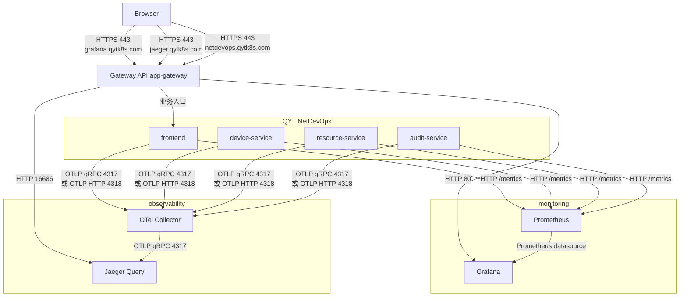
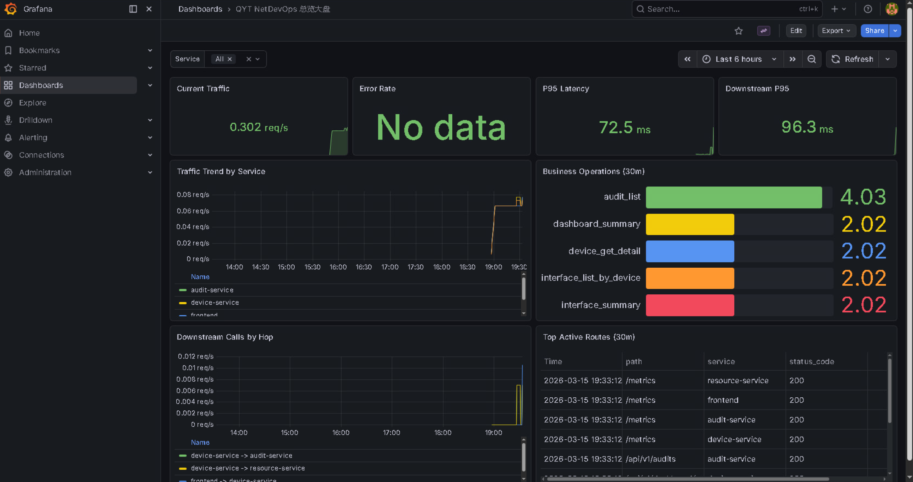
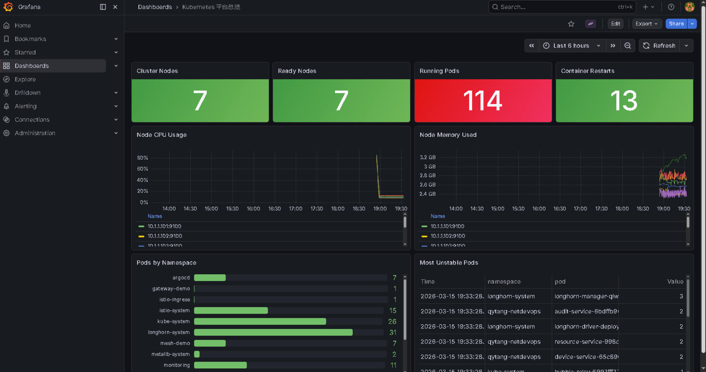
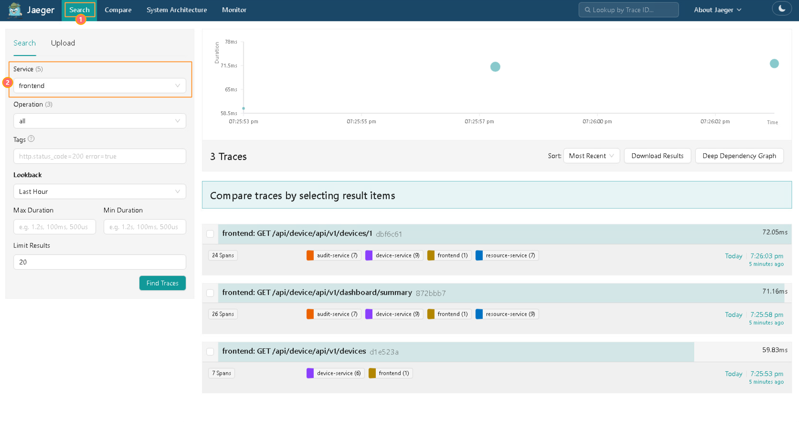
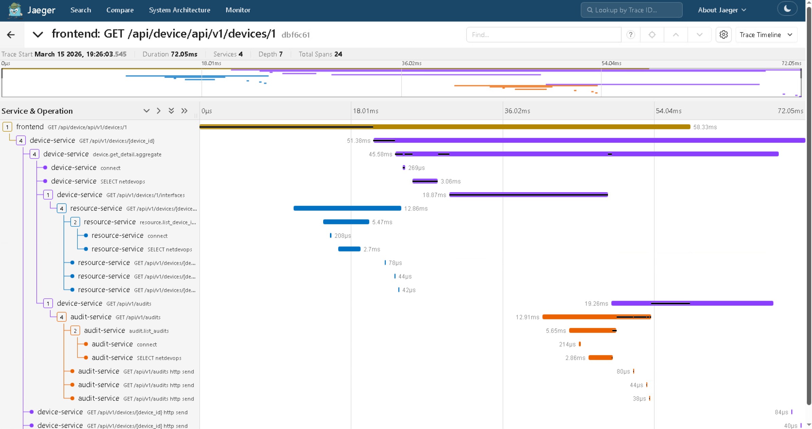

# 第 4 步：Trace 演示与分析

## 本步目标

用一条真实业务请求，把第七章的主线讲完整：

- 先从 K8s / 应用指标发现异常
- 再进入 Trace 找到慢点
- 最后定位到具体服务或下游调用

## 理论说明

这一页不是重新安装组件，而是把前面已经铺好的能力串成课堂演示闭环。

要讲清楚的认知是：

- `Metrics` 适合先发现异常
- `Trace` 适合再定位异常
- 两者结合，才是现代微服务平台真正的可观测性

---

## 演示总关系图



---

## 建议先触发一轮业务流量

<div style="padding: 10px 14px; border: 1px solid #666; border-left: 4px solid #8ab4f8; border-radius: 6px; background: rgba(138,180,248,0.08); margin: 8px 0;">
<strong>ℹ️ 可选执行</strong><br/>
下面 3 条请求不会改系统状态，但强烈建议先执行一轮，这样后面看 Grafana 和 Jaeger 会更直观。
</div>

### 请求 1：先取一个真实设备 ID

```bash
DEVICE_ID=$(curl --resolve netdevops.qytk8s.com:443:10.1.1.60 \
  --cacert /docker_k8s_2026/k8s/01-k8s-architecture/pki/harbor/harbor-ca.crt \
  -s https://netdevops.qytk8s.com/api/device/api/v1/devices | python3 -c 'import json,sys; print(json.load(sys.stdin)[0]["id"])')
```

这条请求的作用是：

- 访问设备列表接口
- 从返回结果里取出第一台设备的 `id`
- 给后面的“设备详情请求”准备一个真实参数

这一条本身的重点不是性能观察，而是为后续 Trace 演示准备真实业务对象。

### 请求 2：触发 Dashboard 汇总链路

```bash
curl --resolve netdevops.qytk8s.com:443:10.1.1.60 \
  --cacert /docker_k8s_2026/k8s/01-k8s-architecture/pki/harbor/harbor-ca.crt \
  -s https://netdevops.qytk8s.com/api/device/api/v1/dashboard/summary >/dev/null
```

这条请求的作用是：

- 访问 Dashboard 汇总接口
- 触发 `device-service` 做全局汇总
- 进一步调用下游服务拿接口统计和审计概览

这一条更适合在 `Grafana` 中观察：

- 汇总接口请求量
- 汇总接口延迟
- 相关服务的整体调用趋势

### 请求 3：触发设备详情链路

```bash
curl --resolve netdevops.qytk8s.com:443:10.1.1.60 \
  --cacert /docker_k8s_2026/k8s/01-k8s-architecture/pki/harbor/harbor-ca.crt \
  -s "https://netdevops.qytk8s.com/api/device/api/v1/devices/${DEVICE_ID}" >/dev/null
```

这条请求的作用是：

- 访问单设备详情接口
- 触发 `device-service` 查询设备主体信息
- 再去下游补接口/资源明细和审计记录

这一条最适合在 `Jaeger` 中看完整 Trace，因为它更容易形成一条跨多个服务的下钻链路。

关键看点：

- 第 1 条请求先准备一个真实设备 ID
- 第 2 条请求更适合看全局汇总型指标
- 第 3 条请求更适合看单设备下钻型 Trace
- 三条请求连起来后，后面看 `Grafana` 和 `Jaeger` 会更直观

---

## 课堂演示顺序

### Grafana

- 访问 `https://grafana.qytk8s.com`
- 先打开 `QYT NetDevOps` 总览大盘
- 再打开 Kubernetes 平台大盘
- 重点看请求量、接口延迟、错误率和节点 / Pod 状态

先看业务总览大盘：



再看 Kubernetes 平台大盘：



这一段最适合先回答两个问题：

- 是业务接口变慢了，还是平台资源先出现异常
- 是单个服务有问题，还是整个集群状态已经异常

### 触发业务流量

- 依次执行前面的 3 条请求
- 先让指标发生变化，再让 `Jaeger` 中出现新的 Trace

### Jaeger

- 访问 `https://jaeger.qytk8s.com`
- 在 `Service` 中优先选择 `frontend` 或 `device-service`
- 再点 `Find Traces`
- 最后进入单条 Trace 看瀑布图

先看查询结果页：



再进入单条 Trace 的瀑布图详情页：



这一段最适合继续回答两个问题：

- 慢点是在 `device-service` 自己，还是在下游调用
- 慢的是 `resource-service`、`audit-service`，还是数据库相关 span

---

## 通过标准

满足下面条件，就说明第七章已经完整闭环：

- 你能先从 `Grafana` 指标看到业务或平台现象
- 你能在 `Jaeger` 中找到对应 Trace
- 你能指出慢调用落在哪个服务或哪个 span

---

## 课堂结论

这一节要让学员真正建立下面认知：

- 看 Pod `Running` 远远不够
- Metrics 负责快速发现异常
- Trace 负责精确定位异常链路
- `Jaeger` 的瀑布图最适合课堂上讲解调用耗时分布
- K8s 指标和微服务 Trace 组合起来，才是完整的现代可观测闭环
