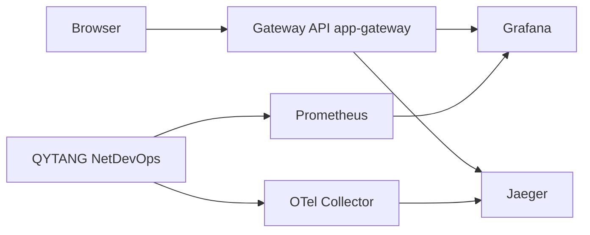

# 第 4 步：安装 Prometheus、Grafana、Jaeger 与 OTel Collector

## 本步目标

把第七章需要的观测栈一次性装进集群，并把 `Grafana` 与 `Jaeger` 正式挂到现有 `Gateway` 入口上。

本步完成后，应达到下面状态：

- 业务代码已同步到 Git 仓库
- 业务镜像已更新到带可观测能力的新版本
- 业务 Deployment 已完成滚动
- Kubernetes 基础指标已被采集
- 业务服务指标已被采集
- `Grafana` 已就绪
- `Jaeger` 已就绪
- `OpenTelemetry Collector` 已就绪

## 本步脚本

- `k8s/07-observability-and-tracing/scripts/02_install_observability_stack.sh`

## 执行命令

```bash
bash /docker_k8s_2026/k8s/07-observability-and-tracing/scripts/02_install_observability_stack.sh
```

## 理论说明

这一页要同时完成 3 层动作：

1. 升级业务应用
现在集群里跑的还是前一章交付的业务版本。本步会先把带指标和 Trace 的第七章版本发布上去。

2. 安装可观测组件
本步会安装：

- `kube-prometheus-stack`
- `Jaeger`
- `OpenTelemetry Collector`

3. 发布正式可视化入口
本步不会新建一个独立 Gateway，而是把第七章自己的入口对象增量补到现有 `app-gateway` 上：

- `grafana.qytk8s.com`
- `jaeger.qytk8s.com`

## 总关系图



## 脚本关键任务

脚本会按下面顺序执行：

1. 检查 Helm 与命名空间
2. 同步第七章业务代码到 Git 仓库
3. 构建并推送带 `OpenTelemetry` 能力的新镜像
4. 等待业务 Deployment 滚动完成
5. 安装 `kube-prometheus-stack`
6. 安装 `Jaeger`
7. 安装 `OpenTelemetry Collector`
8. 创建业务 `ServiceMonitor`
9. 将第七章自己的 `listener` 增量补到 `app-gateway`
10. 应用第七章自己的 `HTTPRoute / ReferenceGrant`
11. 下发 `Grafana` 自定义大盘

## 本步会用到的关键 YAML

### `01_kube_prometheus_stack_values.yaml`

关键字段：

- `grafana.persistence.enabled: true`
- `grafana.persistence.storageClassName: longhorn`
- `prometheus.prometheusSpec.storageSpec`
- 多个组件的 `nodeSelector: node-role: observability`

重点含义：

- `Grafana` 和 `Prometheus` 都会把数据落到 `Longhorn`
- 这一章的观测组件优先调度到 `wk-obs01`

### `02_jaeger_values.yaml`

关键字段：

- `jaeger.nodeSelector`
- `receivers.otlp`
- `extensions.jaeger_query`

重点含义：

- `Jaeger` 也优先放到观测节点
- `OTLP` 是第七章微服务上报 Trace 的正式入口
- `jaeger` Service 暴露了后面通过 Gateway 对外发布的查询界面

### `20_gateway_observability_listeners.json`

关键字段：

- `grafana-http / grafana-https`
- `jaeger-http / jaeger-https`
- `certificateRefs`

重点含义：

- 这一章只给现有 `app-gateway` 增量补 4 个监听器
- 不会覆盖前面章节已经存在的 `longhorn` 和 `netdevops` listener

### `21_gateway_observability_https.yaml`

关键字段：

- `grafana-http-redirect`
- `grafana-https-backend`
- `jaeger-http-redirect`
- `jaeger-https-backend`
- `ReferenceGrant`

重点含义：

- `HTTP` 统一做 `301` 跳转
- `HTTPS` 才真正转发到 `monitoring/kps-grafana` 和 `observability/jaeger`
- 因为 `HTTPRoute` 在 `gateway-demo`，后端 `Service` 在其他命名空间，所以必须显式创建 `ReferenceGrant`

## 预期

- `monitoring` 命名空间出现 `Prometheus` 和 `Grafana`
- `observability` 命名空间出现 `Jaeger` 和 `OTel Collector`
- `QYT NetDevOps` 已经滚动到带指标和 Trace 的新版本
- `Grafana` 可通过正式域名访问
- `Jaeger` 可通过正式域名访问
- `Prometheus` Targets 中能看到业务服务

## 验证方法

```bash
kubectl -n monitoring get pods,svc
```

关键看点：

- 重点看 `kps-grafana`、`prometheus` 相关 Pod 是否已经 `Running`
- 重点看 `kps-grafana` Service 是否存在

预期结果：

- `monitoring` 命名空间中应出现 `Grafana` 和 `Prometheus` 相关资源

```bash
kubectl -n observability get pods,svc
```

关键看点：

- 重点看 `jaeger`、`jaeger-query`、`otel-collector` 是否已经就绪
- 重点看 `jaeger-query` Service 是否存在

预期结果：

- `observability` 命名空间中应出现 `Jaeger` 和 `OTel Collector`

```bash
kubectl get gateway,httproute -n gateway-demo
```

关键看点：

- 重点不是对象数量
- 而是要确认已经出现：
  - `grafana-http-redirect`
  - `grafana-https-backend`
  - `jaeger-http-redirect`
  - `jaeger-https-backend`

预期结果：

- `app-gateway` 仍然存在
- 第七章自己的 `HTTPRoute` 已经创建成功

```bash
curl --resolve grafana.qytk8s.com:443:10.1.1.60 --cacert /docker_k8s_2026/k8s/01-k8s-architecture/pki/harbor/harbor-ca.crt -I https://grafana.qytk8s.com/login
```

```bash
curl --resolve jaeger.qytk8s.com:443:10.1.1.60 --cacert /docker_k8s_2026/k8s/01-k8s-architecture/pki/harbor/harbor-ca.crt -I https://jaeger.qytk8s.com/
```

关键看点：

- 两条命令都要看到成功的 `HTTP` 响应
- 这说明 TLS、Gateway、HTTPRoute 和跨命名空间转发已经一起成立

预期结果：

- `Grafana` 登录页可访问
- `Jaeger` 首页可访问

## 下一步

进入第 5 步，做正式入口、Targets、Dashboard 和 Trace 验收：

- `docs/06_publish_grafana_and_verify.md`
