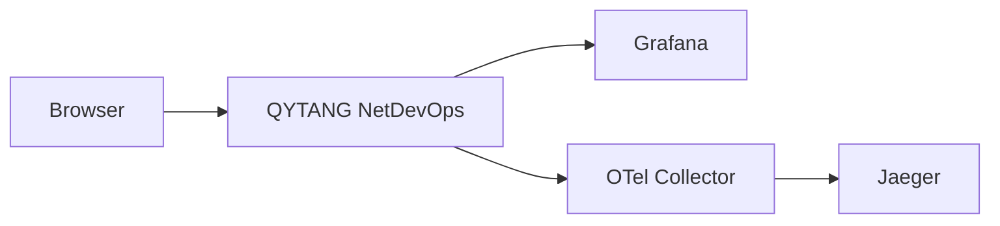

# 第 6 步：Trace 演示与故障定位

## 本步目标

用一条真实业务请求，把第七章的主线讲完整：

- 先从 K8s / 应用指标发现异常
- 再进入 Trace 找到慢点
- 最后定位到具体服务或下游调用

## 理论说明

这一页不是重新安装组件，而是把前面已经铺好的能力串成课堂演示闭环。

要讲清楚的认知是：

- `Metrics` 适合先发现异常
- `Trace` 适合再定位异常
- 两者结合，才是现代微服务平台真正的可观测性

## 演示总关系图



## 建议先触发一轮业务流量

```bash
DEVICE_ID=$(curl --resolve netdevops.qytk8s.com:443:10.1.1.60 \
  --cacert /docker_k8s_2026/k8s/01-k8s-architecture/pki/harbor/harbor-ca.crt \
  -s https://netdevops.qytk8s.com/api/device/api/v1/devices | python3 -c 'import json,sys; print(json.load(sys.stdin)[0]["id"])')
```

```bash
curl --resolve netdevops.qytk8s.com:443:10.1.1.60 \
  --cacert /docker_k8s_2026/k8s/01-k8s-architecture/pki/harbor/harbor-ca.crt \
  -s https://netdevops.qytk8s.com/api/device/api/v1/dashboard/summary >/dev/null
```

```bash
curl --resolve netdevops.qytk8s.com:443:10.1.1.60 \
  --cacert /docker_k8s_2026/k8s/01-k8s-architecture/pki/harbor/harbor-ca.crt \
  -s "https://netdevops.qytk8s.com/api/device/api/v1/devices/${DEVICE_ID}" >/dev/null
```

关键看点：

- 第一条命令取一个真实设备 ID
- 后两条命令会触发前端到多个后端服务的真实调用
- 这样后面看 `Grafana` 和 `Jaeger` 时更容易立刻看到效果

## 建议演示顺序

1. 打开 `Grafana`
2. 先看 `QYT NetDevOps` 总览大盘
3. 再看 Kubernetes 基础监控大盘
4. 触发一次业务访问
5. 打开 `Jaeger`
6. 在 `Jaeger` 中检索请求链路并查看瀑布图

## 推荐观察点

### 指标侧

- 某个服务请求量突然增加
- 某个接口延迟升高
- 某个 Pod 重启次数增加
- 某个节点资源吃紧

### Trace 侧

- `device-service` 是否最慢
- 下游调用是 `resource-service` 慢还是 `audit-service` 慢
- 数据库访问 span 是否异常
- 某个 span 是否把总耗时拉长

## GUI 操作建议

### Grafana

- 访问 `https://grafana.qytk8s.com`
- 先打开 `QYT NetDevOps` 总览大盘
- 再打开 Kubernetes 平台大盘

### Jaeger

- 访问 `https://jaeger.qytk8s.com`
- 在 `Service` 中优先选择 `frontend` 或 `device-service`
- 再点 `Find Traces`
- 最后进入单条 Trace 看瀑布图

## 通过标准

满足下面条件，就说明第七章已经完整闭环：

- 你能先从 `Grafana` 指标看到业务或平台现象
- 你能在 `Jaeger` 中找到对应 Trace
- 你能指出慢调用落在哪个服务或哪个 span

## 课堂结论

这一节要让学员真正建立下面认知：

- 看 Pod `Running` 远远不够
- Metrics 负责快速发现异常
- Trace 负责精确定位异常链路
- `Jaeger` 的瀑布图最适合课堂上讲解调用耗时分布
- K8s 指标和微服务 Trace 组合起来，才是完整的现代可观测闭环
